# Round 2 — all answers (temperature 0, thinking on)

## r01-cars-chart-alerts.png

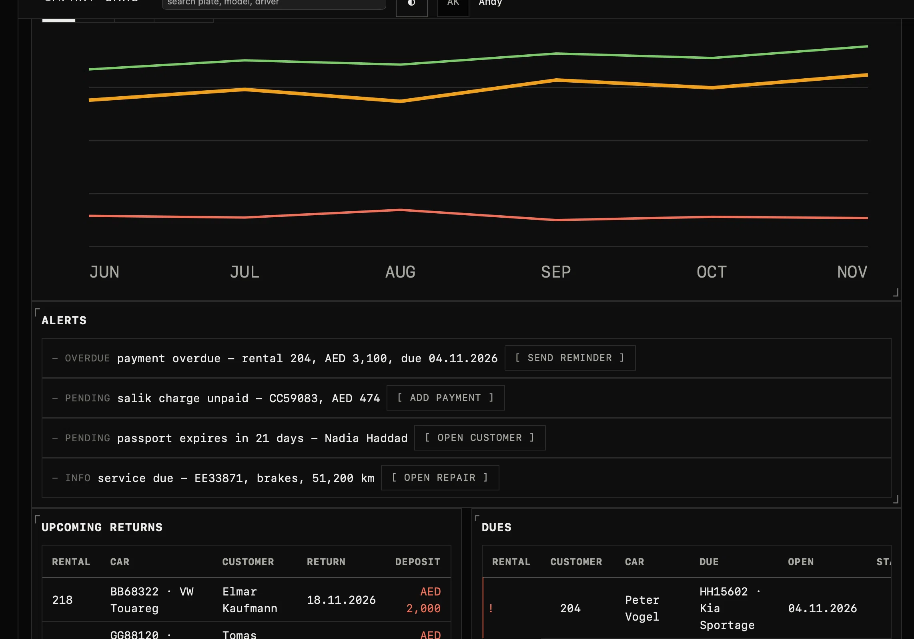

**Prompt**

> Answer each question briefly, numbered:
> 1. How many data lines are in the chart, and what colour is each?
> 2. Which line is highest at NOV?
> 3. How many alert rows are in ALERTS, and are their bracketed action buttons lined up in one common column (same left edge)?
> 4. In the DUES table, is any column header cut off at the right edge? Which?
> 5. In UPCOMING RETURNS, how is the deposit for rental 218 shown (colour, number of lines)?
> 6. Describe any small decorative marks at the corners of the panels.

**F16 @6144** (4.8 s, 3733 prompt tokens, 540 completion tokens)

> 1. Three lines: green (top), orange/amber (middle), red/coral (bottom).
> 2. The green line.
> 3. Four alert rows; no — the bracketed buttons are not aligned in one column (each sits right after its text, so left edges differ).
> 4. Yes — the rightmost header is cut off, showing "STA…" (STATUS).
> 5. In red/orange, split over two lines: "AED" then "2,000".
> 6. Small right‑angle corner brackets (⌐‑style ticks) at the panel corners (e.g. top‑left and bottom‑right), framing each panel.

**F16 @2048** (4.4 s, 2181 prompt tokens, 568 completion tokens)

> 1. Three lines: green (top), orange/amber (middle), red/coral (bottom).
> 2. The green line.
> 3. Four alert rows; no — the bracketed buttons are not aligned in a common column (their left edges vary with text length).
> 4. Yes — the rightmost header is cut off, showing only "ST…" (STATUS).
> 5. In red/orange, split over two lines: "AED" then "2,000".
> 6. Small right‑angle corner brackets (corner ticks) at the panel corners (e.g. top‑left and bottom‑right), framing each panel.

**Q8_0 @6144** (5.9 s, 3733 prompt tokens, 711 completion tokens)

> 1. Three lines: green (top), orange/amber (middle), red/coral (bottom).
> 2. The green line.
> 3. Four alert rows; no — the bracketed buttons are not in a common column, each sits right after its own text (different left edges).
> 4. Yes — the last header is cut off at the right edge, showing "STA…" (STATUS).
> 5. In red/orange, split over two lines: "AED" then "2,000".
> 6. Small L‑shaped corner brackets/ticks at the panel corners (top‑left and bottom‑right).

**Q6_K @6144** (5.6 s, 3733 prompt tokens, 670 completion tokens)

> 1. Three lines: green (top), orange/amber (middle), red/coral (bottom).
> 2. The green line.
> 3. Four alert rows; no — the bracketed buttons are not in a common column, each sits right after its own text (different left edges).
> 4. Yes — the last header is cut off at the right edge, showing "STA…" (STATUS).
> 5. In red/orange, split over two lines: "AED" then "2,000".
> 6. Small L‑shaped corner brackets (corner ticks) mark the panels' corners (top‑left and bottom‑right).

**Q4_0 @6144** (5.2 s, 3733 prompt tokens, 582 completion tokens)

> 1. Three lines: green (top), orange/amber (middle), red/coral (bottom).
> 2. The green line.
> 3. Four alert rows; no — the bracketed buttons sit right after each text string, so their left edges are not aligned in a common column.
> 4. Yes — the last header is cut off at the right edge ("ST…", i.e. STATUS).
> 5. In red/orange, split over two lines: "AED" then "2,000".
> 6. Small right‑angle corner brackets (corner ticks) at the panel corners (e.g. top‑left and bottom‑right), like ⌐ / ⌞ marks.

## r02-cars-detail.png

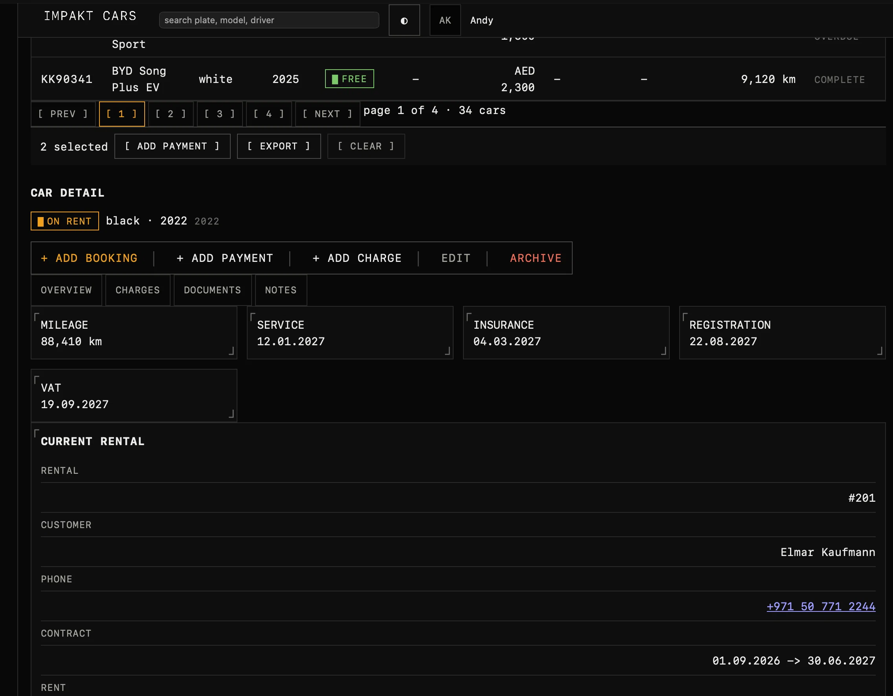

**Prompt**

> Answer each question briefly, numbered:
> 1. Which pagination button is the active page and how is it marked?
> 2. Of the three buttons after '2 selected', which looks disabled/dimmed?
> 3. The line under CAR DETAIL repeats one value. What is repeated?
> 4. How many info tiles are in the first row, and where does the next tile go?
> 5. How many thin vertical separator lines are between the items of the action bar (+ ADD BOOKING ... ARCHIVE)?
> 6. Which of the tabs OVERVIEW / CHARGES / DOCUMENTS / NOTES looks selected?
> 7. Is there a visible gap between the tab row and the tiles below it?
> 8. In CURRENT RENTAL, where is each value placed relative to its label?

**F16 @6144** (10.7 s, 4121 prompt tokens, 1002 completion tokens)

> 1. Page **1** is active — marked by an orange/highlighted border around `[ 1 ]`.
> 2. **`[ CLEAR ]`** looks disabled/dimmed (grayed text).
> 3. **2022** is repeated (bold "2022" then dimmed "2022").
> 4. **4** tiles in the first row (MILEAGE, SERVICE, INSURANCE, REGISTRATION); the next tile (VAT) wraps to a **new row below**, on the left.
> 5. **4** thin vertical separators (between BOOKING|PAYMENT, PAYMENT|CHARGE, CHARGE|EDIT, EDIT|ARCHIVE).
> 6. **OVERVIEW** looks selected (brighter text).
> 7. **Yes** — a small gap between the tab row and the tiles.
> 8. Each value is **right-aligned on its own line below** the left-side label.

**F16 @2048** (6.7 s, 2205 prompt tokens, 775 completion tokens)

> 1. Page **1** is active, marked by an orange/highlighted border box around `[ 1 ]`.
> 2. **`[ CLEAR ]`** looks disabled/dimmed (grayed text and faint border).
> 3. The year **2022** is repeated (once bold, once dimmed).
> 4. **4** tiles in the first row (MILEAGE, SERVICE, INSURANCE, REGISTRATION); the next tile (VAT) wraps to a new row at the left.
> 5. **4** thin vertical separator lines.
> 6. **OVERVIEW** looks selected (lighter background).
> 7. **No** meaningful gap — the tiles sit directly beneath the tab row.
> 8. Each value is **right-aligned on its own line below** the left-aligned label.

**Q8_0 @6144** (10.0 s, 4121 prompt tokens, 881 completion tokens)

> 1. Page **1** is active — marked by an orange/highlighted border around `[ 1 ]`.
> 2. **`[ CLEAR ]`** looks disabled/dimmed (grayed text).
> 3. The year **2022** is repeated (bold "2022" then dimmed "2022").
> 4. **4** tiles in the first row (MILEAGE, SERVICE, INSURANCE, REGISTRATION); the next tile (VAT) wraps to a **new row below**, on the left.
> 5. **4** thin vertical separators (between BOOKING|PAYMENT, PAYMENT|CHARGE, CHARGE|EDIT, EDIT|ARCHIVE).
> 6. **OVERVIEW** looks selected (brighter text).
> 7. **Yes** — a small gap between the tab row and the tiles.
> 8. Each value is **right-aligned on the line below** its left-aligned label.

**Q6_K @6144** (40.9 s, 4121 prompt tokens, 5830 completion tokens)

> 1. Page **1** — marked by an orange/highlighted border around `[ 1 ]`.
> 2. `[ CLEAR ]` — its text is dimmed/grayed compared to the other two.
> 3. The year **2022** is repeated (once bold, once dimmed).
> 4. **Four** tiles in the first row (MILEAGE, SERVICE, INSURANCE, REGISTRATION); the next tile (VAT) wraps to a **new row below**, on the left.
> 5. **Four** thin vertical separator lines.
> 6. **OVERVIEW** (brighter text / active tab).
> 7. **Yes** — a small gap; the tiles sit slightly below the tab row rather than flush against it.
> 8. Each value is **right‑aligned on the line directly beneath** its left‑aligned label (label left, value right).

**Q4_0 @6144** (9.7 s, 4121 prompt tokens, 827 completion tokens)

> 1. Page **1** is active, marked by an orange/highlighted border around `[ 1 ]`.
> 2. `[ CLEAR ]` looks disabled/dimmed (grayed text).
> 3. The year **2022** is repeated ("2022 2022").
> 4. **4** tiles in the first row (MILEAGE, SERVICE, INSURANCE, REGISTRATION); the next tile (VAT) wraps to a new row below on the left.
> 5. **4** thin vertical separator lines.
> 6. **OVERVIEW** looks selected (brighter text).
> 7. Yes — there is a small visible gap between the tab row and the tiles.
> 8. Each value is right-aligned on the same line, opposite its left-aligned label.

## r03-minimal-example.png

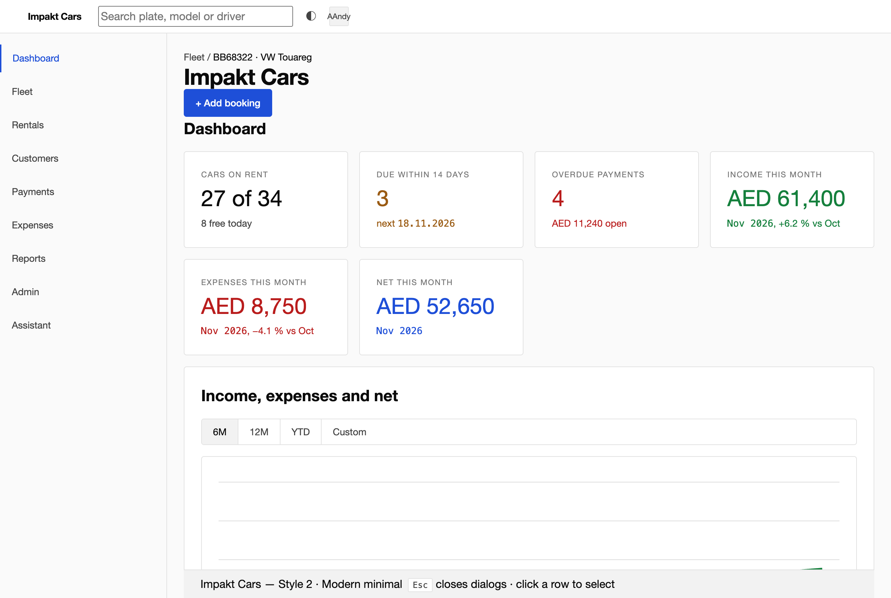

**Prompt**

> Answer each question briefly, numbered:
> 1. What text is in the user chip at the top right of the top bar, exactly as written?
> 2. How much space is there between the blue '+ Add booking' button and the 'Impakt Cars' title above it and the 'Dashboard' heading below it?
> 3. How many KPI cards are in the first row and in the second row?
> 4. Which KPI subtitle lines use a different (monospace) font from the rest?
> 5. What happens at the very bottom of the screen with the grey bar and the chart?

**F16 @6144** (15.1 s, 4498 prompt tokens, 2393 completion tokens)

> 1. **AAndy**
>
> 2. Very little — the button is tightly sandwiched, with only a small gap (roughly 10–15 px) above it (under the "Impakt Cars" title) and a similar small gap below it (above the "Dashboard" heading).
>
> 3. First row: **4** cards; second row: **2** cards.
>
> 4. The date/percentage subtitle lines are monospace: **"next 18.11.2026"**, **"Nov 2026, +6.2 % vs Oct"**, **"Nov 2026, −4.1 % vs Oct"**, and **"Nov 2026"**. (The other subtitles — "8 free today" and "AED 11,240 open" — use the normal sans font.)
>
> 5. The grey footer bar overlaps/covers the bottom edge of the chart, hiding its lower axis and labels; only a tiny green line segment peeks out at the bottom‑right corner.

**F16 @2048** (6.0 s, 2213 prompt tokens, 906 completion tokens)

> 1. **AAndy**
>
> 2. Roughly equal, small gaps (~8 px) on both sides — the button sits tightly between the title and the heading.
>
> 3. First row: **4** cards; second row: **2** cards.
>
> 4. The date/number subtitles use monospace: "next 18.11.2026", "AED 11,240 open", "Nov 2026, +6.2 % vs Oct", "Nov 2026, −4.1 % vs Oct", and "Nov 2026". ("8 free today" uses the regular font.)
>
> 5. The grey footer bar overlaps the chart, covering/obscuring its bottom edge (the axis line and the green trend line are cut off behind it).

**Q8_0 @6144** (29.1 s, 4498 prompt tokens, 4684 completion tokens)

> 1. **AAndy**
>
> 2. Only a small gap on each side — roughly **15 px** above (to the "Impakt Cars" title) and roughly **13–15 px** below (to the "Dashboard" heading); the button is tightly sandwiched between them.
>
> 3. First row: **4** cards. Second row: **2** cards.
>
> 4. The date‑bearing subtitle lines use the monospace font: **"next 18.11.2026"**, **"Nov 2026, +6.2 % vs Oct"**, **"Nov 2026, −4.1 % vs Oct"**, and **"Nov 2026"**. (The other two subtitles — "8 free today" and "AED 11,240 open" — are in the regular sans font.)
>
> 5. The grey footer bar **overlaps the chart**, covering/cutting off its bottom portion — the chart continues behind the bar and is partially hidden.

**Q6_K @6144** (20.2 s, 4498 prompt tokens, 3167 completion tokens)

> 1. "AAndy" (avatar initial "A" + name "Andy", rendered together in the chip).
> 2. Very little — the button is snugly sandwiched with roughly equal small gaps (~5–8 px) between the "Impakt Cars" title above and the "Dashboard" heading below.
> 3. First row: 4 cards; second row: 2 cards.
> 4. The date/percentage subtitle lines are monospace: "next 18.11.2026", "Nov 2026, +6.2 % vs Oct", "Nov 2026, −4.1 % vs Oct", and "Nov 2026". ("8 free today" and "AED 11,240 open" use the normal sans font.)
> 5. The grey footer/status bar overlaps the chart, clipping/covering its bottom edge (only a thin sliver of the chart's bottom line peeks out above the bar).

**Q4_0 @6144** (10.7 s, 4498 prompt tokens, 1428 completion tokens)

> 1. **AAndy**
>
> 2. Small, roughly equal gaps on both sides (≈12–20 px); the button sits snugly between the "Impakt Cars" title above and the "Dashboard" heading below, with slightly more room below than above.
>
> 3. First row: **4** cards. Second row: **2** cards.
>
> 4. All subtitle lines except "8 free today" are monospace: *next 18.11.2026*, *AED 11,240 open*, *Nov 2026, +6.2 % vs Oct*, *Nov 2026, −4.1 % vs Oct*, and *Nov 2026*. ("8 free today" uses the normal sans‑serif font.)
>
> 5. The grey footer bar overlays the bottom of the chart, covering its lower area / x‑axis so the chart is cut off; only a small green line segment peeks out just above the bar on the right.

## r04-meta-elements.png

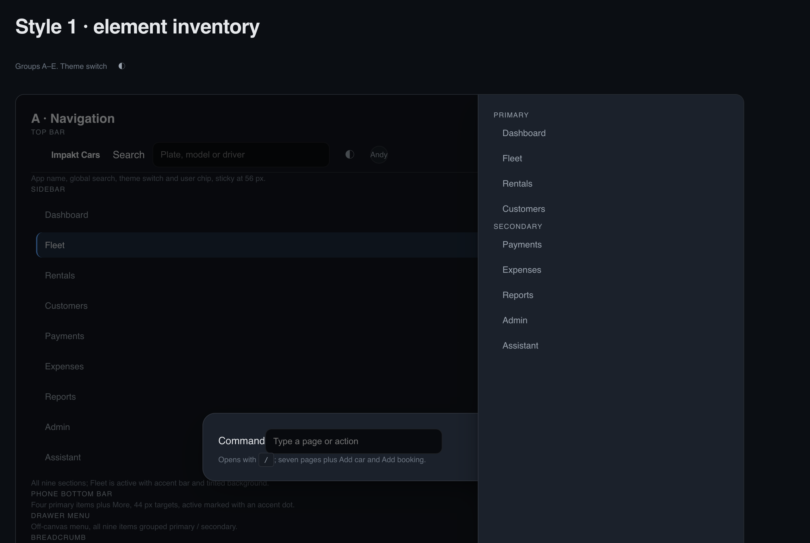

**Prompt**

> Answer each question briefly, numbered:
> 1. Which elements overlap each other on this page?
> 2. Which sidebar item is active and how is it marked?
> 3. What are the two group headings in the right-hand panel?
> 4. Is the 'A · Navigation' heading the same brightness as normal text?

**F16 @6144** (30.6 s, 4440 prompt tokens, 4205 completion tokens)

> 1. The Command palette box overlaps the right‑hand drawer panel (its right edge is clipped/hidden behind it) and also overlaps the descriptive paragraph beneath it.
> 2. "Fleet" is active, marked by an accent bar on its left edge plus a tinted/highlighted background.
> 3. PRIMARY and SECONDARY.
> 4. No — it's rendered dimmed/muted, lower brightness than the normal bright text.

**F16 @2048** (11.3 s, 2155 prompt tokens, 1517 completion tokens)

> 1. The **Command panel** (the rounded box with the "Type a page or action" input) overlaps the left **sidebar / navigation list**, sitting on top of its rows.
> 2. **Fleet** is active — marked by an accent bar on its left edge plus a tinted/highlighted background.
> 3. **PRIMARY** and **SECONDARY**.
> 4. **No** — it's rendered in a muted, dimmed gray (low contrast), about the same brightness as the body text rather than a brighter heading color, so it doesn't stand out.

**Q8_0 @6144** (14.9 s, 4440 prompt tokens, 1479 completion tokens)

> 1. The **Command** panel overlaps the left sidebar list (covering the Admin/Assistant rows), and the right-hand **drawer menu** panel overlaps the main inventory content (dimming it with a scrim).
> 2. **Fleet** is active — marked by an accent bar on its left edge plus a tinted background.
> 3. **PRIMARY** and **SECONDARY**.
> 4. No — it is dimmed to the same muted gray as the surrounding body text (the whole card is darkened by the open drawer's overlay), so it is not emphasized/bright like the page title.

**Q6_K @6144** (15.4 s, 4440 prompt tokens, 1590 completion tokens)

> 1. The **Command** panel overlaps both the left sidebar list (sitting over Admin/Assistant) and the left edge of the right‑hand drawer panel.
> 2. **Fleet** is active — marked by a left accent bar plus a tinted background.
> 3. **PRIMARY** and **SECONDARY**.
> 4. Yes — it's muted to the same brightness as normal text (only the weight is heavier), so it doesn't stand out as a heading.

**Q4_0 @6144** (35.1 s, 4440 prompt tokens, 4672 completion tokens)

> 1. The **Command popover** overlaps the sidebar navigation list (the Admin/Assistant rows) and the descriptive caption text beneath it.
> 2. **Fleet** is active — marked with a left accent bar plus a tinted/highlighted background.
> 3. **PRIMARY** and **SECONDARY**.
> 4. Yes — it's rendered in the same dimmed, muted gray as the surrounding body/secondary text (not the bright white title), so it doesn't stand out as a heading.

## r05-telltale-example.png

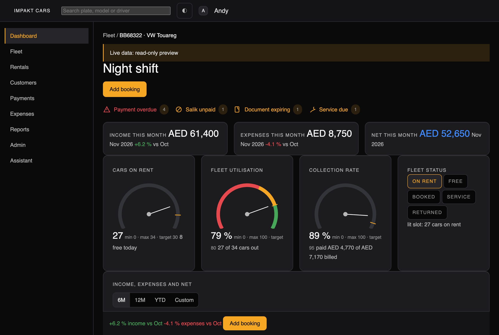

**Prompt**

> Answer each question briefly, numbered:
> 1. List the four alert chips under 'Add booking' with their counts.
> 2. Which FLEET STATUS chip is highlighted?
> 3. Look at the text under each gauge. Is anything wrong with how it wraps or runs together?
> 4. Do the left/right edges of the 3 top summary cards line up with the edges of the 4 gauge cards below them?
> 5. Compare the vertical gap between the summary row and the gauge row with the horizontal gaps between cards. Consistent?
> 6. What colours are on the FLEET UTILISATION gauge arc?

**F16 @6144** (14.6 s, 4502 prompt tokens, 2305 completion tokens)

> 1. Payment overdue (4), Salik unpaid (1), Document expiring (1), Service due (1).
> 2. ON RENT (orange outline/text).
> 3. Yes — the target values are orphaned onto the second line and run into the description: "target 30 8 / free today", "target / 80 27 of 34 cars out", "target / 95 paid AED 4,770…". The word "target" dangles at the end of line 1 while its number (8, 80, 95) collides with the next line's text.
> 4. Yes — the outer left edges and outer right edges align; only the internal column dividers differ (3 cards vs 4).
> 5. No — the vertical gap between the rows is noticeably smaller than the ~30 px horizontal gaps between cards.
> 6. Red → orange/amber → green (segmented arc).

**F16 @2048** (19.6 s, 2217 prompt tokens, 3302 completion tokens)

> 1. Payment overdue (4), Salik unpaid (1), Document expiring (1), Service due (1).
> 2. ON RENT (orange border/text; the others are inactive grey).
> 3. Yes — the "target" value and the descriptive line wrap badly. In two cards the word "target" is orphaned at the end of line 1 while its number falls to line 2 and collides with the sentence ("target / 80 27 of 34 cars out", "target / 95 paid AED 4,770…"). In the first card the stray "8" is pulled up onto the target line ("target 30 8") instead of starting "free today".
> 4. The outer left and right edges of both rows line up (same total width), but the internal column boundaries do not match, since the top row has 3 columns and the gauge row has 4.
> 5. No — the vertical gap between the summary row and the gauge row is noticeably larger than the horizontal gaps between cards, so the spacing is inconsistent.
> 6. Red → orange/amber → green (a segmented gradient arc).

**Q8_0 @6144** (10.6 s, 4502 prompt tokens, 1548 completion tokens)

> 1. Payment overdue (4), Salik unpaid (1), Document expiring (1), Service due (1).
> 2. ON RENT (orange outline/text).
> 3. Yes — the "target" value wraps onto the next line and collides with the following text: "target 30 8 / free today", "target / 80 27 of 34 cars out", "target / 95 paid AED 4,770…". The target number and the next sentence run together.
> 4. The outer left/right edges align (same container width), but the internal column dividers don't (3 columns vs 4).
> 5. No — the vertical gap between the rows is much smaller than the ~horizontal gaps between cards.
> 6. Red → amber/orange → green.

**Q6_K @6144** (9.8 s, 4502 prompt tokens, 1441 completion tokens)

> 1. Payment overdue (4), Salik unpaid (1), Document expiring (1), Service due (1).
> 2. ON RENT (orange outline/text).
> 3. Yes — the "target" value wraps to the next line and collides with the following text: "target 30 8 / free today", "target / 80 27 of 34 cars out", "target / 95 paid AED…". The target number and the descriptive line run together.
> 4. Outer left/right edges align (first card left and last card right match), but the internal column edges don't (3 vs 4 columns), as expected.
> 5. No — the vertical gap between the rows is much tighter (~a few px) than the horizontal gaps between cards (~30 px).
> 6. Red → amber/orange → green.

**Q4_0 @6144** (12.1 s, 4502 prompt tokens, 1799 completion tokens)

> 1. Payment overdue (4), Salik unpaid (1), Document expiring (1), Service due (1).
> 2. ON RENT (orange outline/text).
> 3. Yes — the target value and the following caption run together / split badly across lines: "target 30 8 / free today", "target / 80 27 of 34 cars out", "target / 95 paid AED 4,770…". The number after "target" gets orphaned onto the wrong line and jams into the next phrase.
> 4. Only the outermost left and right edges align; the internal column edges do not (3 columns vs 4 columns).
> 5. No — the vertical gap between the two rows is noticeably smaller than the horizontal gaps between cards.
> 6. Red → orange/amber → green.

## r06-terminal-mobile.png

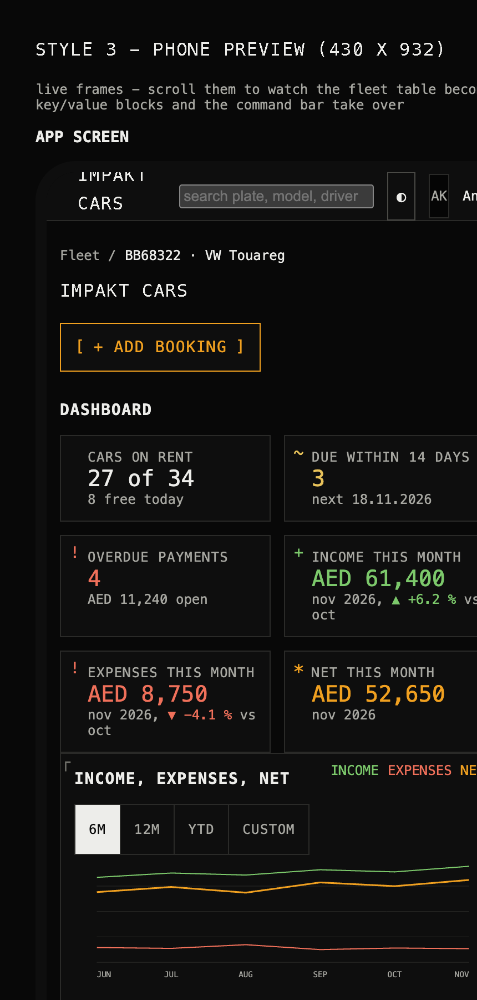

**Prompt**

> Answer each question briefly, numbered:
> 1. What content is cut off at the right edge of the phone frame?
> 2. Which single-character symbols appear before the card titles, and on which cards?
> 3. Is the 'IMPAKT CARS' logo text in the top bar fully visible?
> 4. Which range tab (6M / 12M / YTD / CUSTOM) is active and how is it shown?

**F16 @6144** (5.8 s, 1657 prompt tokens, 861 completion tokens)

> 1. The top‑bar user name/avatar (shows only "An…") and the chart legend label "NET" (shows only "NE…") are clipped at the right edge.
> 2. `~` before "DUE WITHIN 14 DAYS"; `!` before "OVERDUE PAYMENTS" and "EXPENSES THIS MONTH"; `+` before "INCOME THIS MONTH"; `*` before "NET THIS MONTH" (none on "CARS ON RENT").
> 3. No — "IMPAKT" is cut off at the top (letter tops clipped); only "CARS" is fully visible.
> 4. **6M** is active, shown with a light/white filled background while 12M / YTD / CUSTOM stay dark.

**F16 @2048** (5.8 s, 1657 prompt tokens, 861 completion tokens)

> 1. The top‑bar user name/avatar (shows only "An…") and the chart legend label "NET" (shows only "NE…") are clipped at the right edge.
> 2. `~` before "DUE WITHIN 14 DAYS"; `!` before "OVERDUE PAYMENTS" and "EXPENSES THIS MONTH"; `+` before "INCOME THIS MONTH"; `*` before "NET THIS MONTH" (none on "CARS ON RENT").
> 3. No — "IMPAKT" is cut off at the top (letter tops clipped); only "CARS" is fully visible.
> 4. **6M** is active, shown with a light/white filled background while 12M / YTD / CUSTOM stay dark.

**Q8_0 @6144** (7.3 s, 1657 prompt tokens, 1056 completion tokens)

> 1. The top‑bar user name/avatar ("An…"), the right‑hand dashboard cards (e.g. "DUE WITHIN 14 DAYS" and the income card's trailing "vs"), and the chart legend ("NET" truncated to "NE").
> 2. `~` on DUE WITHIN 14 DAYS; `!` on OVERDUE PAYMENTS and EXPENSES THIS MONTH; `+` on INCOME THIS MONTH; `*` on NET THIS MONTH.
> 3. No — the top of "IMPAKT" is clipped by the phone frame's rounded top edge (only "CARS" is fully visible).
> 4. 6M is active, shown as a filled light/white box while 12M / YTD / CUSTOM stay dark with gray text.

**Q6_K @6144** (9.1 s, 1657 prompt tokens, 1454 completion tokens)

> 1. The top‑bar user name/avatar (shows only "An…"), the right‑hand dashboard cards (their right borders and trailing text, e.g. the income card's "vs" line), and the chart legend word "NET" (truncated to "NE").
> 2. `~` before "DUE WITHIN 14 DAYS"; `!` before "OVERDUE PAYMENTS" and "EXPENSES THIS MONTH"; `+` before "INCOME THIS MONTH"; `*` before "NET THIS MONTH". ("CARS ON RENT" has no symbol.)
> 3. No — the top of "IMPAKT" is clipped by the phone frame's top edge; only "CARS" is fully visible.
> 4. "6M" is active, shown with a light/white background fill (the other tabs stay dark).

**Q4_0 @6144** (12.4 s, 1657 prompt tokens, 1913 completion tokens)

> 1. The user's name beside the "AK" avatar (only "An…" shows) and the chart legend's third label "NET" (shows "NE"); the right borders of the right‑column cards are also clipped by the frame.
> 2. `~` before "DUE WITHIN 14 DAYS"; `!` before "OVERDUE PAYMENTS" and "EXPENSES THIS MONTH"; `+` before "INCOME THIS MONTH"; `*` before "NET THIS MONTH" ("CARS ON RENT" has none).
> 3. No — the "IMPAKT" line is clipped at the top edge of the frame (only the lower part of the letters is visible); "CARS" is fully visible.
> 4. "6M" is active, shown with a light/white filled background while the other tabs stay dark with just a border.

## r07-minimal-elements.png

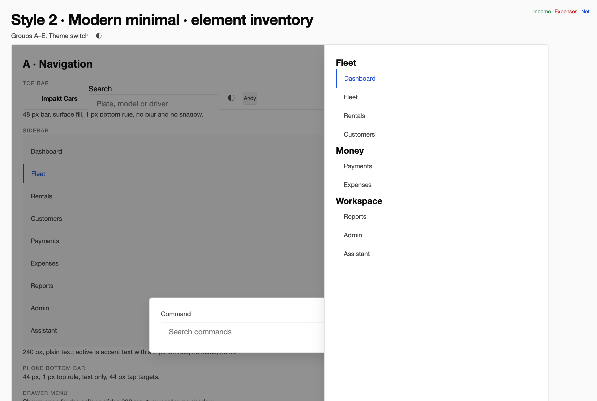

**Prompt**

> Answer each question briefly, numbered:
> 1. Describe any text or elements that overlap or collide in the TOP BAR area.
> 2. Which item is active in the left SIDEBAR, and which in the right panel? How are they marked?
> 3. What are the group headings in the right panel?
> 4. What is the small coloured text at the top right corner of the page?
> 5. Why does the left panel look grey?

**F16 @6144** (8.8 s, 4467 prompt tokens, 560 completion tokens)

> 1. In the TOP BAR the descriptive caption line ("48 px bar, surface fill, 1 px bottom rule…") collides with the bottom edge/border of the "Plate, model or driver" search input box — the text runs through/behind the field. The "Search" label also sits very close to the input's top edge.
>
> 2. Left SIDEBAR active item = **Fleet**; right panel active item = **Dashboard**. Both are marked with accent‑coloured (blue) text plus a vertical accent rule on the left edge.
>
> 3. Right‑panel group headings: **Fleet**, **Money**, **Workspace**.
>
> 4. Top‑right coloured text: **Income** (green), **Expenses** (red), **Net** (blue).
>
> 5. The left panel looks grey because a modal/dialog (the "Command" search overlay) is open, and a dimming scrim/overlay is laid over the background content, desaturating it.

**F16 @2048** (7.2 s, 2182 prompt tokens, 886 completion tokens)

> 1. The search input box ("Plate, model or driver") extends below the top bar's bottom rule and collides with the descriptive caption text underneath it ("48 px bar, surface fill, 1 px bottom rule, no blur and no shadow"); the bar's 1 px bottom rule also runs through the search field.
>
> 2. Left sidebar active item: **Fleet**. Right panel active item: **Dashboard**. Both are marked with accent‑coloured (blue) text plus a vertical accent rule on the left edge.
>
> 3. **Fleet**, **Money**, **Workspace**.
>
> 4. **Income** (green), **Expenses** (red), **Net** (blue).
>
> 5. The left panel is dimmed by a modal scrim/overlay because the "Command" palette is open, so the background content is greyed out behind the overlay.

**Q8_0 @6144** (8.7 s, 4467 prompt tokens, 481 completion tokens)

> 1. The search input box ("Plate, model or driver") extends below the top bar's bottom rule and overlaps/collides with the descriptive caption text underneath ("48 px bar, surface fill, 1 px bottom rule, no blur and no shadow."). The "Search" label also sits partly over the bar's edge.
>
> 2. Left sidebar active item: **Fleet**. Right panel active item: **Dashboard**. Both are marked with accent (blue) text plus a vertical left rule (≈2 px).
>
> 3. Right panel group headings: **Fleet**, **Money**, **Workspace**.
>
> 4. Top‑right coloured text: **Income** (green), **Expenses** (red), **Net** (blue).
>
> 5. The left panel looks grey because a translucent scrim/overlay is dimming it while the right drawer panel is open (modal drawer state), so the underlying content appears darkened/greyed.

**Q6_K @6144** (8.9 s, 4467 prompt tokens, 525 completion tokens)

> 1. In the TOP BAR the search input box ("Plate, model or driver") overlaps/collides with the descriptive caption line below it ("48 px bar, surface fill, 1 px bottom rule, no blur and no shadow."), which is partly hidden behind the field's bottom edge.
>
> 2. Left SIDEBAR active item = **Fleet**; right panel active item = **Dashboard**. Both are marked with accent (blue) text plus a vertical left rule/border.
>
> 3. Right panel group headings: **Fleet**, **Money**, **Workspace**.
>
> 4. Top‑right coloured text: **Income** (green), **Expenses** (red), **Net** (blue).
>
> 5. The left panel looks grey because a modal/dialog (the "Command" palette) is open, applying a dimming scrim/overlay over that area.

**Q4_0 @6144** (9.1 s, 4467 prompt tokens, 552 completion tokens)

> 1. The search input box ("Plate, model or driver") collides with the caption line below it — its bottom border overlaps/cuts off the text "48 px bar, surface fill, 1 px bottom rule, no blur and no shadow." The "Search" label also sits directly above the field, crowding the bar.
>
> 2. Left sidebar active item: **Fleet** (blue text + 2 px left rule). Right panel active item: **Dashboard** (blue text + left vertical bar).
>
> 3. Right panel group headings: **Fleet**, **Money**, **Workspace**.
>
> 4. Top-right coloured text: **Income** (green), **Expenses** (red), **Net** (blue).
>
> 5. The left panel is grey because a modal/drawer (the Command palette + right panel) is open, applying a dimming scrim/overlay backdrop over the underlying page content.

## s02-button-gaps.png

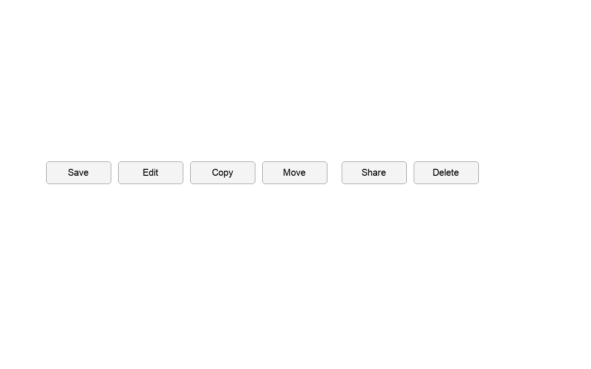

**Prompt**

> How many buttons are there, and is the spacing between neighbouring buttons equal? If not, between which two buttons is the gap different?
> End your reply with one final line exactly in this form: ANSWER: <first button>-<second button> or ANSWER: equal

**F16 @6144** (5.0 s, 1110 prompt tokens, 866 completion tokens)

> Counting the buttons, there are six: Save, Edit, Copy, Move, Share, Delete.
>
> Checking the horizontal gaps between each pair of neighbouring buttons, the gaps between Save–Edit, Edit–Copy, Copy–Move, and Share–Delete are all the same (about 12 px). However, the gap between Move and Share is noticeably larger (about 24 px), roughly double the others.
>
> ANSWER: Move-Share

**F16 @2048** (5.0 s, 1110 prompt tokens, 866 completion tokens)

> Counting the buttons, there are six: Save, Edit, Copy, Move, Share, Delete.
>
> Checking the horizontal gaps between each pair of neighbouring buttons, the gaps between Save–Edit, Edit–Copy, Copy–Move, and Share–Delete are all the same (about 12 px). However, the gap between Move and Share is noticeably larger (about 24 px), roughly double the others.
>
> ANSWER: Move-Share

**Q8_0 @6144** (4.8 s, 1110 prompt tokens, 817 completion tokens)

> There are **6** buttons: Save, Edit, Copy, Move, Share, Delete.
>
> Checking the horizontal gaps between neighbouring buttons, the spacing is uniform (≈12 px) between Save–Edit, Edit–Copy, Copy–Move, and Share–Delete. However, the gap between **Move** and **Share** is noticeably larger (≈24 px), so the spacing is not equal.
>
> ANSWER: Move-Share

**Q6_K @6144** (4.5 s, 1110 prompt tokens, 780 completion tokens)

> Counting the buttons, there are six: Save, Edit, Copy, Move, Share, Delete.
>
> Checking the horizontal gaps between each pair of neighbouring buttons:
>
> - Save → Edit: small gap
> - Edit → Copy: small gap
> - Copy → Move: small gap
> - Move → Share: noticeably larger gap
> - Share → Delete: small gap
>
> The spacing is therefore **not** equal. The gap between **Move** and **Share** is wider than all the others.
>
> ANSWER: Move-Share

**Q4_0 @6144** (4.2 s, 1110 prompt tokens, 728 completion tokens)

> There are **6** buttons: Save, Edit, Copy, Move, Share, Delete.
>
> Checking the horizontal gaps between neighbouring buttons:
>
> - Save → Edit: small gap
> - Edit → Copy: small gap
> - Copy → Move: small gap
> - Move → Share: **larger gap**
> - Share → Delete: small gap
>
> The spacing is not uniform — the gap between **Move** and **Share** is noticeably wider than the others.
>
> ANSWER: Move-Share

## s04-dialog-centering.png

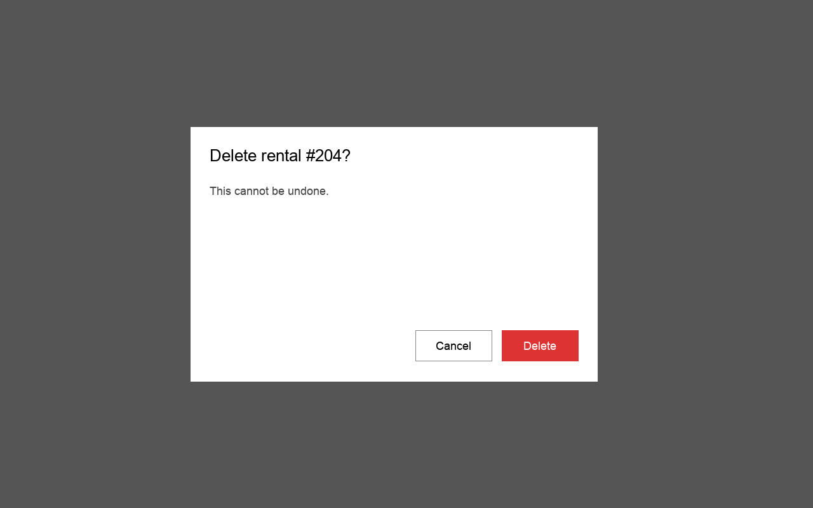

**Prompt**

> Is the white dialog exactly horizontally centred on the dark background? If not, which side has the bigger margin?
> End your reply with one final line exactly in this form: ANSWER: centred / bigger-left / bigger-right

**F16 @6144** (5.7 s, 1101 prompt tokens, 888 completion tokens)

> Looking at the pixel boundaries, the white dialog spans roughly from x ≈ 237 to x ≈ 747 on a 1024‑pixel‑wide canvas.
>
> - Left dark margin ≈ 237 px
> - Right dark margin ≈ 1024 − 747 = 277 px
>
> Since the right margin is larger than the left, the dialog is shifted slightly to the left of the true horizontal centre (its centre is at ≈ 492 px instead of 512 px). Therefore it is **not** exactly centred, and the bigger margin is on the right side.
>
> ANSWER: bigger-right

**F16 @2048** (5.7 s, 1101 prompt tokens, 888 completion tokens)

> Looking at the pixel boundaries, the white dialog spans roughly from x ≈ 237 to x ≈ 747 on a 1024‑pixel‑wide canvas.
>
> - Left dark margin ≈ 237 px
> - Right dark margin ≈ 1024 − 747 = 277 px
>
> Since the right margin is larger than the left, the dialog is shifted slightly to the left of the true horizontal centre (its centre is at ≈ 492 px instead of 512 px). Therefore it is **not** exactly centred, and the bigger margin is on the right side.
>
> ANSWER: bigger-right

**Q8_0 @6144** (11.1 s, 1101 prompt tokens, 1884 completion tokens)

> Looking at the pixel positions, the white dialog's left edge sits at roughly x ≈ 298 and its right edge at roughly x ≈ 938, on an image that is 1280 px wide. That gives a left margin of about 298 px and a right margin of about 342 px. Since the dialog's centre (≈ 618) is left of the image centre (640), the box is shifted leftward, leaving more dark space on the right.
>
> ANSWER: bigger-right

**Q6_K @6144** (5.8 s, 1101 prompt tokens, 892 completion tokens)

> Looking at the pixel coordinates, the white dialog's left edge sits at roughly x ≈ 298 and its right edge at roughly x ≈ 940, giving a box width of about 642 px and a horizontal centre of about x ≈ 619. The image's horizontal centre is x = 640, so the dialog is shifted slightly to the left. That means the left dark margin (~298 px) is smaller than the right dark margin (~340 px).
>
> ANSWER: bigger-right

**Q4_0 @6144** (5.2 s, 1101 prompt tokens, 803 completion tokens)

> Looking at the pixel positions, the white dialog's left edge sits at roughly x ≈ 298, while its right edge sits at roughly x ≈ 938. With the full image width being 1280 px, the left dark margin is about 298 px and the right dark margin is about 1280 − 938 = 342 px. Since 342 > 298, the dialog is shifted left of centre and the right side has the larger margin.
>
> ANSWER: bigger-right

## s07-tab-underline.png

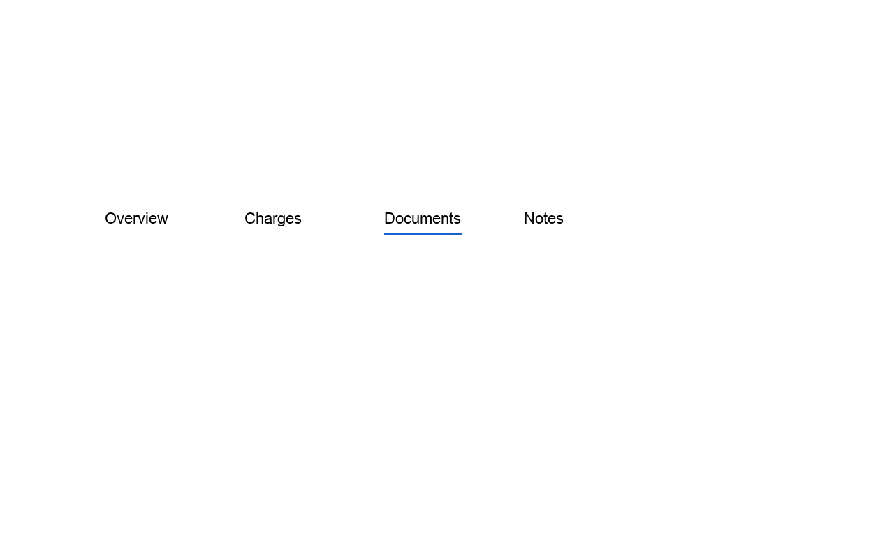

**Prompt**

> Which tab is marked as the active tab, and how is it marked?
> End your reply with one final line exactly in this form: ANSWER: <tab name>

**F16 @6144** (2.7 s, 1089 prompt tokens, 223 completion tokens)

> The active tab is **Documents**. It is distinguished from the other tabs (Overview, Charges, Notes) by a blue horizontal underline drawn directly beneath its label, which is the visual indicator of selection.
>
> ANSWER: Documents

**F16 @2048** (2.6 s, 1089 prompt tokens, 223 completion tokens)

> The active tab is **Documents**. It is distinguished from the other tabs (Overview, Charges, Notes) by a blue horizontal underline drawn directly beneath its label, which is the visual indicator of selection.
>
> ANSWER: Documents

**Q8_0 @6144** (2.7 s, 1089 prompt tokens, 245 completion tokens)

> The active tab is **Documents**. It is distinguished from the other tabs (Overview, Charges, Notes) by a blue horizontal underline beneath the label, while the remaining tabs have no underline.
>
> ANSWER: Documents

**Q6_K @6144** (2.6 s, 1089 prompt tokens, 220 completion tokens)

> The active tab is **Documents**. It is distinguished from the other tabs (Overview, Charges, Notes) by a blue horizontal underline drawn directly beneath its label, while the remaining tabs have no such underline.
>
> ANSWER: Documents

**Q4_0 @6144** (2.5 s, 1089 prompt tokens, 219 completion tokens)

> The active tab is **Documents**. It is marked by a blue horizontal underline drawn directly beneath the tab label, distinguishing it from the other tabs (Overview, Charges, Notes), which have no underline.
>
> ANSWER: Documents

## s08-dashed-divider.png

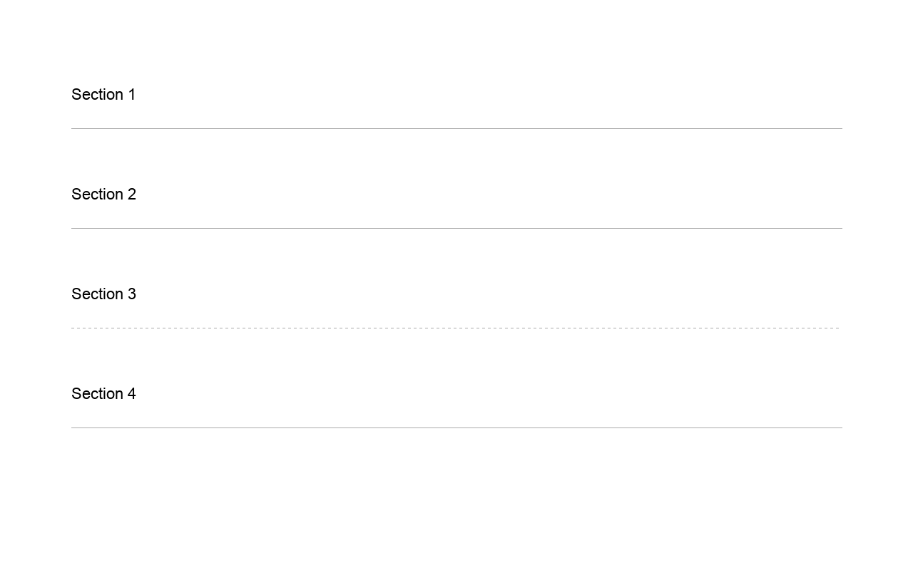

**Prompt**

> Which divider line looks different from the others, and how?
> End your reply with one final line exactly in this form: ANSWER: Section <number>

**F16 @6144** (3.3 s, 1086 prompt tokens, 440 completion tokens)

> Looking at each horizontal rule beneath the headings:
>
> - **Section 1** – solid line
> - **Section 2** – solid line
> - **Section 3** – dashed/dotted line (made of short segments with gaps)
> - **Section 4** – solid line
>
> So the divider under **Section 3** is the odd one out: it is rendered as a dashed line, whereas the dividers for Sections 1, 2, and 4 are continuous solid lines.
>
> ANSWER: Section 3

**F16 @2048** (3.4 s, 1086 prompt tokens, 440 completion tokens)

> Looking at each horizontal rule beneath the headings:
>
> - **Section 1** – solid line
> - **Section 2** – solid line
> - **Section 3** – dashed/dotted line (made of short segments with gaps)
> - **Section 4** – solid line
>
> So the divider under **Section 3** is the odd one out: it is rendered as a dashed line, whereas the dividers for Sections 1, 2, and 4 are continuous solid lines.
>
> ANSWER: Section 3

**Q8_0 @6144** (3.2 s, 1086 prompt tokens, 409 completion tokens)

> Looking at each divider line beneath the headings:
>
> - **Section 1** – solid line
> - **Section 2** – solid line
> - **Section 3** – dashed/dotted line (broken into small segments with gaps)
> - **Section 4** – solid line
>
> The divider under **Section 3** is the odd one out: it is rendered as a dashed line, whereas the dividers for Sections 1, 2, and 4 are continuous solid lines.
>
> ANSWER: Section 3

**Q6_K @6144** (3.4 s, 1086 prompt tokens, 416 completion tokens)

> Looking at each horizontal rule beneath the headings:
>
> - **Section 1** – solid line
> - **Section 2** – solid line
> - **Section 3** – dashed/dotted line (broken into short segments with gaps)
> - **Section 4** – solid line
>
> The divider under **Section 3** is the odd one out: it is rendered as a dashed (dotted) line, whereas the dividers for Sections 1, 2, and 4 are continuous solid lines.
>
> ANSWER: Section 3

**Q4_0 @6144** (3.2 s, 1086 prompt tokens, 417 completion tokens)

> Looking at each horizontal rule beneath the headings:
>
> - **Section 1** – solid line
> - **Section 2** – solid line
> - **Section 3** – dashed / dotted line (broken into short segments with gaps)
> - **Section 4** – solid line
>
> So the divider under **Section 3** is the odd one out: it is rendered as a dashed (dotted) line, while the dividers for Sections 1, 2, and 4 are continuous solid lines.
>
> ANSWER: Section 3

## s10-icon-size.png

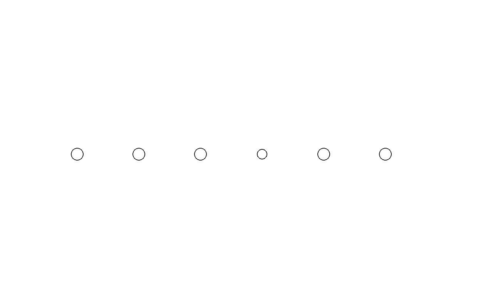

**Prompt**

> Are all the circles the same size? If not, which one is different (count from the left) and how?
> End your reply with one final line exactly in this form: ANSWER: <position from left> <smaller|bigger> or ANSWER: all equal

**F16 @6144** (3.1 s, 1112 prompt tokens, 420 completion tokens)

> Looking at the six circles from left to right, I compared their diameters. The circles at positions 1, 2, 3, 5, and 6 all have the same radius (roughly the same visual size). The circle at position 4 is visibly smaller than the rest.
>
> ANSWER: 4 smaller

**F16 @2048** (3.1 s, 1112 prompt tokens, 420 completion tokens)

> Looking at the six circles from left to right, I compared their diameters. The circles at positions 1, 2, 3, 5, and 6 all have the same radius (roughly the same visual size). The circle at position 4 is visibly smaller than the rest.
>
> ANSWER: 4 smaller

**Q8_0 @6144** (3.3 s, 1112 prompt tokens, 408 completion tokens)

> Looking at the six circles from left to right, the first, second, third, fifth, and sixth circles all have the same diameter. The fourth circle, however, is noticeably smaller than the rest.
>
> ANSWER: 4 smaller

**Q6_K @6144** (3.3 s, 1112 prompt tokens, 397 completion tokens)

> Looking at the six circles from left to right, the first, second, third, fifth, and sixth circles all have the same diameter. The fourth circle, however, is visibly smaller than the rest.
>
> ANSWER: 4 smaller

**Q4_0 @6144** (3.2 s, 1112 prompt tokens, 389 completion tokens)

> Looking at the six circles from left to right, the first, second, third, fifth, and sixth circles all appear to have the same diameter. The fourth circle, however, is noticeably smaller than the others.
>
> ANSWER: 4 smaller

## h02-button-gaps-small.png

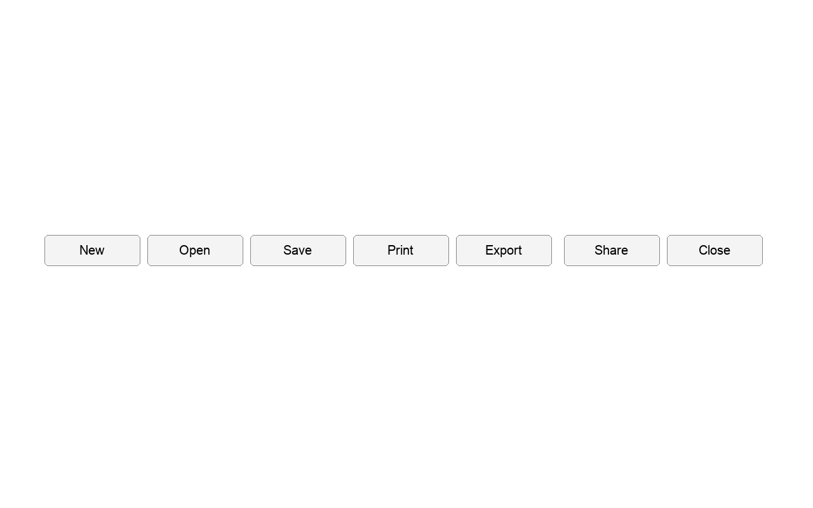

**Prompt**

> Is the spacing between all neighbouring buttons exactly equal? If not, between which two buttons is it different?
> End your reply with one final line exactly in this form: ANSWER: <first button>-<second button> or ANSWER: equal

**F16 @6144** (6.0 s, 1104 prompt tokens, 1042 completion tokens)

> Looking at the horizontal positions of the buttons, the gaps between most neighbouring pairs are uniform (about 12 px). However, the gap between the **Export** button and the **Share** button is noticeably wider than the others (the step from Export's left edge to Share's left edge is larger than the consistent step used elsewhere).
>
> So the spacing is not exactly equal.
>
> ANSWER: Export-Share

**F16 @2048** (6.0 s, 1104 prompt tokens, 1042 completion tokens)

> Looking at the horizontal positions of the buttons, the gaps between most neighbouring pairs are uniform (about 12 px). However, the gap between the **Export** button and the **Share** button is noticeably wider than the others (the step from Export's left edge to Share's left edge is larger than the consistent step used elsewhere).
>
> So the spacing is not exactly equal.
>
> ANSWER: Export-Share

**Q8_0 @6144** (7.3 s, 1104 prompt tokens, 1260 completion tokens)

> Looking at the horizontal gaps between the buttons, the spacing is uniform (≈12 px) for most pairs, but the gap between **Export** and **Share** is noticeably larger (≈20 px). This is also visible in the center‑to‑center distances: all neighboring centers are 162 px apart except Export→Share, which is 170 px apart.
>
> ANSWER: Export-Share

**Q6_K @6144** (5.5 s, 1104 prompt tokens, 897 completion tokens)

> Looking at the horizontal positions of each button, the gaps between consecutive buttons are uniform (≈9 px) for New–Open, Open–Save, Save–Print, Print–Export, and Share–Close. However, the gap between **Export** and **Share** is noticeably larger (≈17 px), breaking the even spacing.
>
> ANSWER: Export-Share

**Q4_0 @6144** (6.6 s, 1104 prompt tokens, 1021 completion tokens)

> Looking at the horizontal gaps between each pair of adjacent buttons, the spacing is uniform (≈9 px) for New–Open, Open–Save, Save–Print, Print–Export, and Share–Close. However, the gap between **Export** and **Share** is noticeably wider (≈19 px), breaking the equal spacing.
>
> ANSWER: Export-Share

## h03-dialog-12px.png

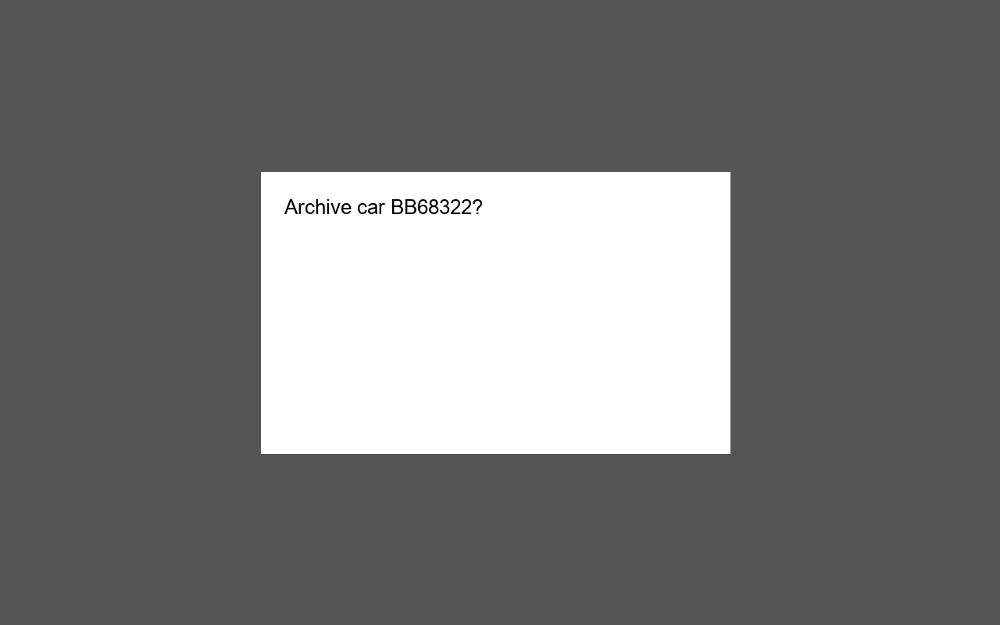

**Prompt**

> Is the white dialog exactly horizontally centred? If not, which side has the bigger margin?
> End your reply with one final line exactly in this form: ANSWER: centred / bigger-left / bigger-right

**F16 @6144** (16.7 s, 1097 prompt tokens, 2843 completion tokens)

> Looking at the gray background (≈1280 px wide), the white dialog's left edge sits at roughly x ≈ 333 and its right edge at roughly x ≈ 933. That gives a left margin of about 333 px and a right margin of about 347 px, so the dialog is shifted slightly to the left and the right margin is larger. (Vertically it is centred, but horizontally it is not.)
>
> ANSWER: bigger-right

**F16 @2048** (16.8 s, 1097 prompt tokens, 2843 completion tokens)

> Looking at the gray background (≈1280 px wide), the white dialog's left edge sits at roughly x ≈ 333 and its right edge at roughly x ≈ 933. That gives a left margin of about 333 px and a right margin of about 347 px, so the dialog is shifted slightly to the left and the right margin is larger. (Vertically it is centred, but horizontally it is not.)
>
> ANSWER: bigger-right

**Q8_0 @6144** (4.5 s, 1097 prompt tokens, 647 completion tokens)

> Looking at the pixel positions, the white dialog's left edge sits at roughly x = 333 and its right edge at roughly x = 933, within a 1280‑pixel‑wide canvas.
>
> - Left margin ≈ 333 px
> - Right margin ≈ 1280 − 933 = 347 px
>
> Since the right margin is larger than the left, the dialog is shifted slightly to the left and is not exactly centred.
>
> ANSWER: bigger-right

**Q6_K @6144** (6.0 s, 1097 prompt tokens, 923 completion tokens)

> Looking at the image, the white dialog box does not sit exactly in the middle of the canvas. Its left edge is closer to the left border than its right edge is to the right border, meaning the gray margin on the right side is wider than the gray margin on the left side. Therefore the dialog is shifted slightly to the left, and the right margin is the larger one.
>
> ANSWER: bigger-right

**Q4_0 @6144** (6.0 s, 1097 prompt tokens, 957 completion tokens)

> Looking at the pixel boundaries of the white dialog box, its left edge sits at roughly x = 333 and its right edge at roughly x = 933, giving a box width of about 600 px. The image width is 1280 px, so the left gray margin is about 333 px while the right gray margin is about 1280 − 933 = 347 px. The box’s horizontal centre is therefore around x = 633, which is slightly left of the image centre (640). This means the dialog is not perfectly centred, and the right‑hand margin is the larger one.
>
> ANSWER: bigger-right

## h05-circle-small-diff.png

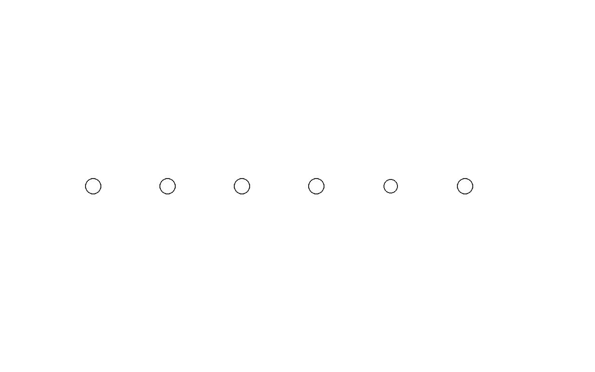

**Prompt**

> Are all the circles exactly the same size? If not, which one (count from the left) differs?
> End your reply with one final line exactly in this form: ANSWER: <position from left> <smaller|bigger> or ANSWER: all equal

**F16 @6144** (4.3 s, 1110 prompt tokens, 598 completion tokens)

> Looking carefully at each circle's outline, the first, second, third, fourth, and sixth circles all have the same diameter. The fifth circle (the one near the right side, before the last) has a noticeably tighter outline — its diameter is smaller than the others.
>
> ANSWER: 5 smaller

**F16 @2048** (4.3 s, 1110 prompt tokens, 598 completion tokens)

> Looking carefully at each circle's outline, the first, second, third, fourth, and sixth circles all have the same diameter. The fifth circle (the one near the right side, before the last) has a noticeably tighter outline — its diameter is smaller than the others.
>
> ANSWER: 5 smaller

**Q8_0 @6144** (3.7 s, 1110 prompt tokens, 532 completion tokens)

> Looking carefully at each circle, the first, second, third, fourth, and sixth circles all have the same diameter. The fifth circle (the one between the fourth and sixth) is visibly smaller than the rest.
>
> ANSWER: 5 smaller

**Q6_K @6144** (4.0 s, 1110 prompt tokens, 573 completion tokens)

> Looking carefully at each circle from left to right, the first, second, third, fourth, and sixth circles all have the same diameter. The fifth circle, however, is noticeably smaller than the rest.
>
> ANSWER: 5 smaller

**Q4_0 @6144** (3.9 s, 1110 prompt tokens, 559 completion tokens)

> Looking at each circle from left to right, I compared their diameters. Circles 1, 2, 3, 4, and 6 all have the same diameter, but the fifth circle is noticeably smaller than the rest.
>
> ANSWER: 5 smaller

## h07-border-colour.png

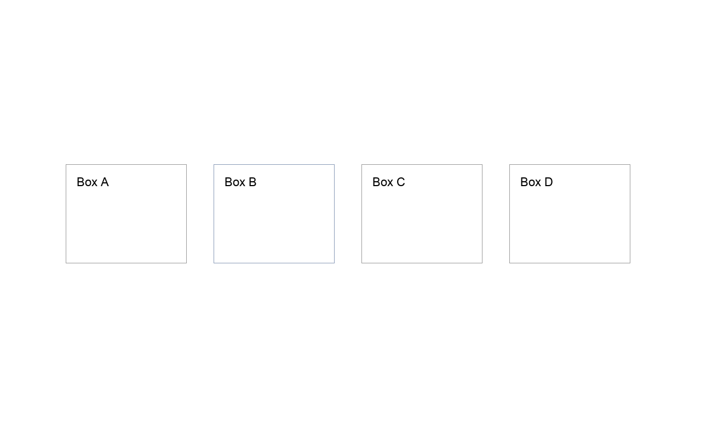

**Prompt**

> Do all four boxes have the same border colour? If not, which box differs and how?
> End your reply with one final line exactly in this form: ANSWER: <box letter> or ANSWER: all same

**F16 @6144** (4.2 s, 1099 prompt tokens, 573 completion tokens)

> Looking closely at the borders of each box:
>
> - **Box A** – border is a neutral gray.
> - **Box B** – border is a light/steel **blue** (the left and top edges clearly show a blue tint).
> - **Box C** – border is a neutral gray.
> - **Box D** – border is a neutral gray.
>
> So the four boxes do **not** all share the same border colour. Box B is the odd one out: its border is blue, whereas the borders of Boxes A, C, and D are gray.
>
> ANSWER: B

**F16 @2048** (4.3 s, 1099 prompt tokens, 573 completion tokens)

> Looking closely at the borders of each box:
>
> - **Box A** – border is a neutral gray.
> - **Box B** – border is a light/steel **blue** (the left and top edges clearly show a blue tint).
> - **Box C** – border is a neutral gray.
> - **Box D** – border is a neutral gray.
>
> So the four boxes do **not** all share the same border colour. Box B is the odd one out: its border is blue, whereas the borders of Boxes A, C, and D are gray.
>
> ANSWER: B

**Q8_0 @6144** (3.4 s, 1099 prompt tokens, 388 completion tokens)

> Looking closely at the borders, three of the boxes (A, C, and D) have a neutral gray outline, while Box B's outline is rendered in a blue/steel‑blue tone. So they are not all the same.
>
> ANSWER: B

**Q6_K @6144** (4.1 s, 1099 prompt tokens, 543 completion tokens)

> Looking closely at the borders of each box:
>
> - **Box A** – border is a neutral gray.
> - **Box B** – border is a blue/steel‑blue colour.
> - **Box C** – border is a neutral gray.
> - **Box D** – border is a neutral gray.
>
> So the four boxes do **not** all share the same border colour. Box B is the odd one out: its outline is blue, whereas the outlines of Boxes A, C, and D are gray.
>
> ANSWER: Box B

**Q4_0 @6144** (4.6 s, 1099 prompt tokens, 634 completion tokens)

> Looking carefully at each box's outline:
>
> - **Box A** – border is a neutral gray.
> - **Box B** – border has a distinct blue/steel‑blue tint (most visible on the left and top edges).
> - **Box C** – border is a neutral gray.
> - **Box D** – border is a neutral gray.
>
> So the borders are **not** all the same. Box B is the odd one out: its border is blue, whereas the other three boxes have gray borders.
>
> ANSWER: B

## d01-dark-hairlines.png

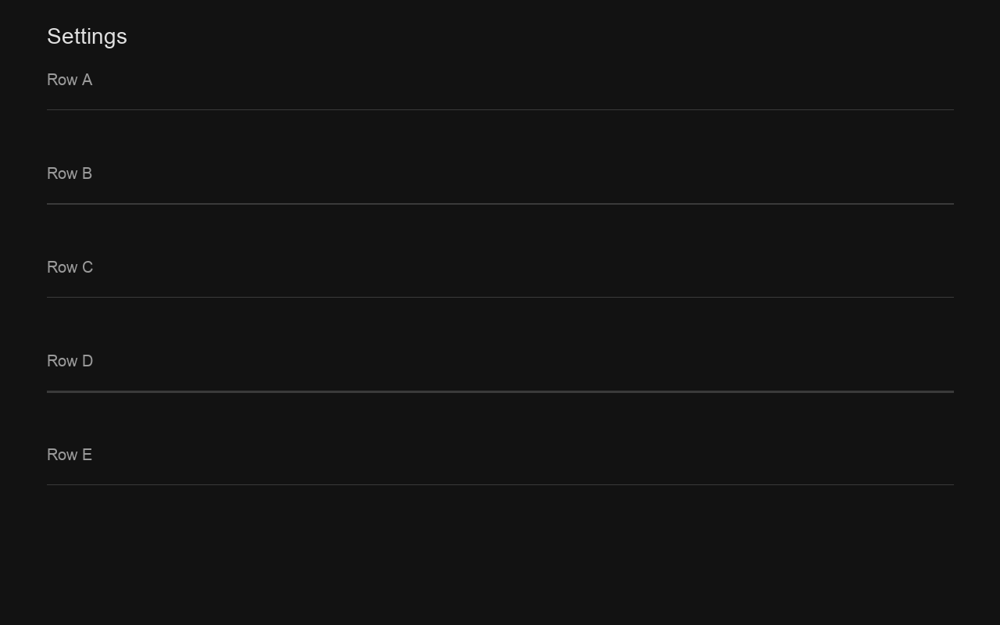

**Prompt**

> There are horizontal divider lines under Row A to Row E. Are they all the same thickness? If not, give each row's line as thin / medium / thick.
> End your reply with one final line exactly in this form: ANSWER: A=<..> B=<..> C=<..> D=<..> E=<..>

**F16 @6144** (27.6 s, 1124 prompt tokens, 4444 completion tokens)

> Looking at each divider line's vertical extent (pixel height):
>
> - **Row A** – a 1‑pixel hairline → thin
> - **Row B** – a 1‑pixel hairline → thin
> - **Row C** – a 1‑pixel hairline → thin
> - **Row D** – a noticeably bolder, multi‑pixel band (≈3 px, lighter gray) → thick
> - **Row E** – a 1‑pixel hairline → thin
>
> So they are **not** all the same thickness; only Row D's line is thicker than the rest.
>
> ANSWER: A=thin B=thin C=thin D=thick E=thin

**F16 @2048** (27.8 s, 1124 prompt tokens, 4444 completion tokens)

> Looking at each divider line's vertical extent (pixel height):
>
> - **Row A** – a 1‑pixel hairline → thin
> - **Row B** – a 1‑pixel hairline → thin
> - **Row C** – a 1‑pixel hairline → thin
> - **Row D** – a noticeably bolder, multi‑pixel band (≈3 px, lighter gray) → thick
> - **Row E** – a 1‑pixel hairline → thin
>
> So they are **not** all the same thickness; only Row D's line is thicker than the rest.
>
> ANSWER: A=thin B=thin C=thin D=thick E=thin

**Q8_0 @6144** (47.0 s, 1124 prompt tokens, 7600 completion tokens)

> Looking closely at each divider, the lines under Row A, Row B, Row C, and Row E are all single‑pixel hairlines (thin). The line under Row D is visibly heavier/bolder than the others (a ~2‑pixel band), so it is medium. No line reaches the "thick" category.
>
> ANSWER: A=thin B=thin C=thin D=medium E=thin

**Q6_K @6144** (52.1 s, 1124 prompt tokens, 8706 completion tokens)

> Looking carefully at each divider line, they are **not** all the same thickness.
>
> - **Row A** – hairline (thin)
> - **Row B** – hairline (thin)
> - **Row C** – hairline (thin)
> - **Row D** – noticeably heavier/brighter band (thick)
> - **Row E** – hairline (thin)
>
> So only Row D's divider is thicker than the rest; the other four are thin hairlines.
>
> ANSWER: A=thin B=thin C=thin D=thick E=thin

**Q4_0 @6144** (19.9 s, 1124 prompt tokens, 3172 completion tokens)

> Looking closely at the vertical extent (pixel height) of each divider:
>
> - **Row A** – a single hairline (1 px) → thin
> - **Row B** – slightly heavier stroke (≈2 px) → medium
> - **Row C** – a single hairline (1 px) → thin
> - **Row D** – clearly the heaviest stroke (≈3 px) → thick
> - **Row E** – a single hairline (1 px) → thin
>
> So they are **not** all the same thickness.
>
> ANSWER: A=thin B=medium C=thin D=thick E=thin

## d03-dark-card-shift.png

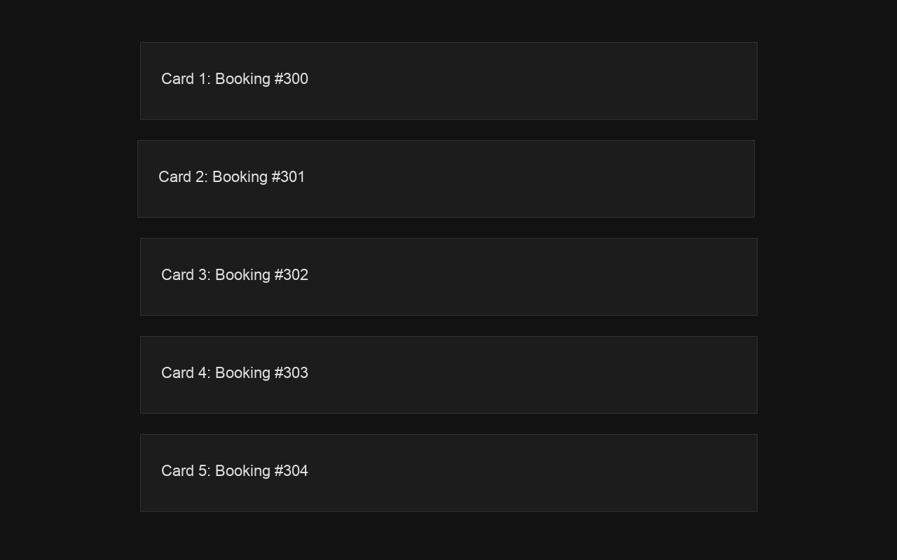

**Prompt**

> Are all the cards exactly left-aligned? If one is shifted, which one and in which direction?
> End your reply with one final line exactly in this form: ANSWER: Card <n> <left|right> or ANSWER: all aligned

**F16 @6144** (25.0 s, 1105 prompt tokens, 4858 completion tokens)

> Looking at the left vertical border of each card, all five cards begin at the same horizontal position (≈155 px from the left edge of the image). The right borders also line up at the same position (≈845 px), and the text inside each card starts at the same x‑coordinate. There is no horizontal offset between any of the cards.
>
> ANSWER: all aligned

**F16 @2048** (25.2 s, 1105 prompt tokens, 4858 completion tokens)

> Looking at the left vertical border of each card, all five cards begin at the same horizontal position (≈155 px from the left edge of the image). The right borders also line up at the same position (≈845 px), and the text inside each card starts at the same x‑coordinate. There is no horizontal offset between any of the cards.
>
> ANSWER: all aligned

**Q8_0 @6144** (41.9 s, 1105 prompt tokens, 7645 completion tokens)

> Looking at the left vertical border of each card rectangle and tracing it down the image, all five left edges sit on the same vertical line (≈ the same x‑position), and the right edges likewise line up. The text inside each card also starts at the same horizontal offset, confirming consistent padding. No card is offset relative to the others.
>
> ANSWER: all aligned

**Q6_K @6144** (36.3 s, 1105 prompt tokens, 6788 completion tokens)

> Looking at the left vertical border of each card, all five rectangles begin at the same horizontal position (≈155 px from the left edge of the image). The right borders also line up at the same position (≈1080 px), and the text inside each card starts at the same x‑coordinate, confirming that no card has been nudged horizontally relative to the others.
>
> ANSWER: all aligned

**Q4_0 @6144** (23.4 s, 1105 prompt tokens, 4203 completion tokens)

> Looking at the left edge of each card rectangle (the thin border) and the starting position of the text inside each card, all five cards share the same left x‑coordinate. The left borders form a single straight vertical line, and the text in every card begins at the same horizontal offset from its border. No card is indented or protruded relative to the others.
>
> ANSWER: all aligned

## d05-dark-missing-border.png

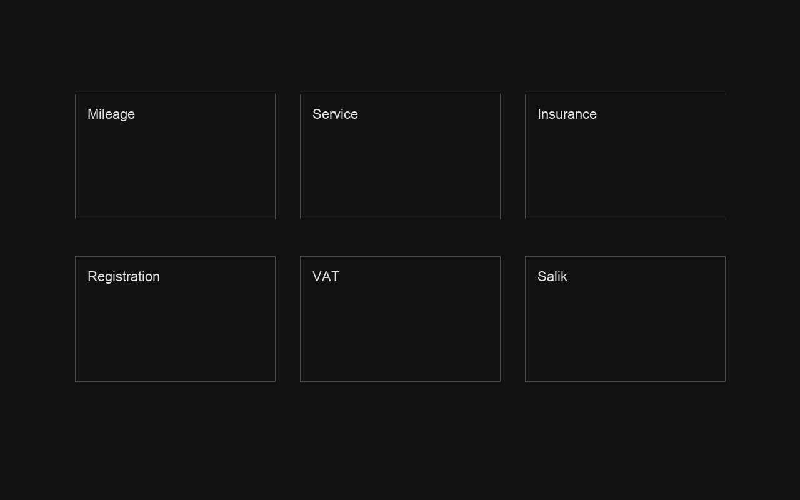

**Prompt**

> Each box should have a complete border on all four sides. Is any box missing part of its border? Which box and which side?
> End your reply with one final line exactly in this form: ANSWER: <box name> <top|bottom|left|right> or ANSWER: none

**F16 @6144** (6.2 s, 1115 prompt tokens, 987 completion tokens)

> Looking at each box, I traced all four edges. The Mileage, Service, Registration, VAT, and Salik boxes each show a complete rectangle (top, bottom, left, and right lines all present).
>
> For the **Insurance** box, the top, left, and bottom edges are drawn, but the vertical line on the right side is absent — the top and bottom horizontal lines end at the right corners without being connected by a vertical segment.
>
> ANSWER: Insurance right

**F16 @2048** (6.3 s, 1115 prompt tokens, 987 completion tokens)

> Looking at each box, I traced all four edges. The Mileage, Service, Registration, VAT, and Salik boxes each show a complete rectangle (top, bottom, left, and right lines all present).
>
> For the **Insurance** box, the top, left, and bottom edges are drawn, but the vertical line on the right side is absent — the top and bottom horizontal lines end at the right corners without being connected by a vertical segment.
>
> ANSWER: Insurance right

**Q8_0 @6144** (6.4 s, 1115 prompt tokens, 1058 completion tokens)

> Looking at each box, I traced all four edges. The Mileage, Service, Registration, VAT, and Salik boxes each show a complete rectangle (top, bottom, left, and right lines). The Insurance box shows its top, bottom, and left edges, but the vertical line on its right side is absent — the top and bottom horizontal lines end at the right corner without being connected by a vertical border.
>
> ANSWER: Insurance right

**Q6_K @6144** (13.0 s, 1115 prompt tokens, 2146 completion tokens)

> Looking at each box, I traced all four edges. The left, top, and bottom borders are clearly present on every box. For the right borders, I can see vertical lines on the right side of Mileage, Service, Registration, VAT, and Salik. However, the Insurance box's top and bottom horizontal lines extend to the right edge, but there is no vertical line connecting them on the right side — that side is open.
>
> ANSWER: Insurance right

**Q4_0 @6144** (4.8 s, 1115 prompt tokens, 705 completion tokens)

> Looking at each box's four edges:
>
> - **Mileage** – top, left, bottom, right all present.
> - **Service** – top, left, bottom, right all present.
> - **Insurance** – top, left, and bottom edges are drawn, but the vertical line on the right side is absent (the top and bottom horizontal lines simply end without a connecting vertical stroke).
> - **Registration** – all four sides present.
> - **VAT** – all four sides present.
> - **Salik** – all four sides present.
>
> So the Insurance box is missing its right border.
>
> ANSWER: Insurance right

## d06-dark-baseline.png

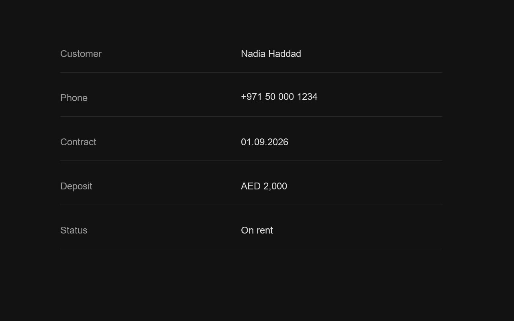

**Prompt**

> In each row, is the value on the right exactly on the same baseline as its label on the left? If a row is off, which one, and is the value higher or lower?
> End your reply with one final line exactly in this form: ANSWER: <row label> <higher|lower> or ANSWER: all aligned

**F16 @6144** (30.8 s, 1124 prompt tokens, 5371 completion tokens)

> Looking at each row, I compared the vertical position (baseline) of the gray label on the left with the white value on the right, using the divider line beneath each row as a reference.
>
> - **Customer / Nadia Haddad** – same baseline.
> - **Phone / +971 50 000 1234** – same baseline.
> - **Contract / 01.09.2026** – same baseline.
> - **Deposit / AED 2,000** – same baseline.
> - **Status / On rent** – same baseline.
>
> In every row the value sits on the exact same baseline as its label; no row is shifted up or down.
>
> ANSWER: all aligned

**F16 @2048** (31.1 s, 1124 prompt tokens, 5371 completion tokens)

> Looking at each row, I compared the vertical position (baseline) of the gray label on the left with the white value on the right, using the divider line beneath each row as a reference.
>
> - **Customer / Nadia Haddad** – same baseline.
> - **Phone / +971 50 000 1234** – same baseline.
> - **Contract / 01.09.2026** – same baseline.
> - **Deposit / AED 2,000** – same baseline.
> - **Status / On rent** – same baseline.
>
> In every row the value sits on the exact same baseline as its label; no row is shifted up or down.
>
> ANSWER: all aligned

**Q8_0 @6144** (23.0 s, 1124 prompt tokens, 3818 completion tokens)

> Looking at each row, I compared the vertical position (baseline) of the gray label on the left with the white value on the right.
>
> - **Customer / Nadia Haddad** – tops and bottoms of the glyphs line up; baselines match.
> - **Phone / +971 50 000 1234** – baselines match.
> - **Contract / 01.09.2026** – baselines match.
> - **Deposit / AED 2,000** – the descender on the “p” in *Deposit* sits below the baseline, but the baseline itself (bottom of “t”) lines up with the bottom of the digits/letters in the value.
> - **Status / On rent** – baselines match.
>
> In every row the value sits on the same baseline as its label; the only visual difference (e.g., the “p” descender in *Deposit*) is below the baseline, not a baseline offset.
>
> ANSWER: all aligned

**Q6_K @6144** (56.3 s, 1124 prompt tokens, 9185 completion tokens)

> Looking at each row, I compared the vertical position (baseline) of the gray label on the left with the white value on the right, using the horizontal divider lines as a reference.
>
> - **Customer / Nadia Haddad** – same baseline.
> - **Phone / +971 50 000 1234** – same baseline.
> - **Contract / 01.09.2026** – same baseline.
> - **Deposit / AED 2,000** – same baseline (the “p” descender hangs below, but the baselines match).
> - **Status / On rent** – same baseline.
>
> In every row the value sits on exactly the same baseline as its label.
>
> ANSWER: all aligned

**Q4_0 @6144** (53.8 s, 1124 prompt tokens, 9082 completion tokens)

> Looking at each row, I compared the baseline (the bottom edge of the non‑descender letters) of the gray label on the left with the baseline of the white value on the right.
>
> - **Customer / Nadia Haddad** – baselines match.
> - **Phone / +971 50 000 1234** – baselines match (the gray “p” descender hangs below, but the baseline itself lines up with the digits).
> - **Contract / 01.09.2026** – baselines match.
> - **Deposit / AED 2,000** – baselines match (gray “p” descender hangs lower, baseline still aligned).
> - **Status / On rent** – baselines match.
>
> In every row the value sits on the same baseline as its label.
>
> ANSWER: all aligned

## d09-dark-gridlines.png

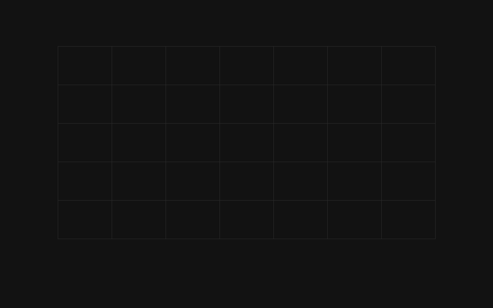

**Prompt**

> Count the vertical lines and the horizontal lines in the grid, including the outer frame edges.
> End your reply with one final line exactly in this form: ANSWER: <vertical> vertical, <horizontal> horizontal

**F16 @6144** (5.3 s, 1097 prompt tokens, 893 completion tokens)

> Looking at the grid, I can identify the structure by counting the cells and the lines that bound them.
>
> **Vertical lines:** The grid has 7 columns of cells. The vertical lines include the left outer edge, the 6 internal column separators, and the right outer edge. That gives 7 + 1 = **8 vertical lines**.
>
> **Horizontal lines:** The grid has 5 rows of cells. The horizontal lines include the top outer edge, the 4 internal row separators, and the bottom outer edge. That gives 5 + 1 = **6 horizontal lines**.
>
> ANSWER: 8 vertical, 6 horizontal

**F16 @2048** (5.3 s, 1097 prompt tokens, 893 completion tokens)

> Looking at the grid, I can identify the structure by counting the cells and the lines that bound them.
>
> **Vertical lines:** The grid has 7 columns of cells. The vertical lines include the left outer edge, the 6 internal column separators, and the right outer edge. That gives 7 + 1 = **8 vertical lines**.
>
> **Horizontal lines:** The grid has 5 rows of cells. The horizontal lines include the top outer edge, the 4 internal row separators, and the bottom outer edge. That gives 5 + 1 = **6 horizontal lines**.
>
> ANSWER: 8 vertical, 6 horizontal

**Q8_0 @6144** (38.5 s, 1097 prompt tokens, 7443 completion tokens)

> Looking at the grid, I can trace the lines from edge to edge.
>
> **Vertical lines:** Starting from the left outer frame edge and moving right, there is the left border, then six internal vertical dividers, then the right border. That gives 8 columns of cells and **9 vertical lines**.
>
> **Horizontal lines:** Starting from the top outer frame edge and moving down, there is the top border, then four internal horizontal dividers, then the bottom border. That gives 5 rows of cells and **6 horizontal lines**.
>
> ANSWER: 9 vertical, 6 horizontal

**Q6_K @6144** (15.4 s, 1097 prompt tokens, 2964 completion tokens)

> Looking at the grid, I can identify the structure by counting the cells and the lines that bound them.
>
> **Vertical lines:** The grid is divided into 7 columns. The vertical lines include the left outer edge, the 6 internal column separators, and the right outer edge. That gives 7 + 1 = **8 vertical lines**.
>
> **Horizontal lines:** The grid is divided into 5 rows. The horizontal lines include the top outer edge, the 4 internal row separators, and the bottom outer edge. That gives 5 + 1 = **6 horizontal lines**.
>
> ANSWER: 8 vertical, 6 horizontal

**Q4_0 @6144** (5.9 s, 1097 prompt tokens, 1082 completion tokens)

> Looking at the grid, I traced each line including the outer frame.
>
> **Vertical lines** (left to right): the left edge, then 6 interior dividers, then the right edge → 8 vertical lines (forming 7 columns).
>
> **Horizontal lines** (top to bottom): the top edge, then 4 interior dividers, then the bottom edge → 6 horizontal lines (forming 5 rows).
>
> ANSWER: 8 vertical, 6 horizontal

## e01-dark-card-shift-3px.png

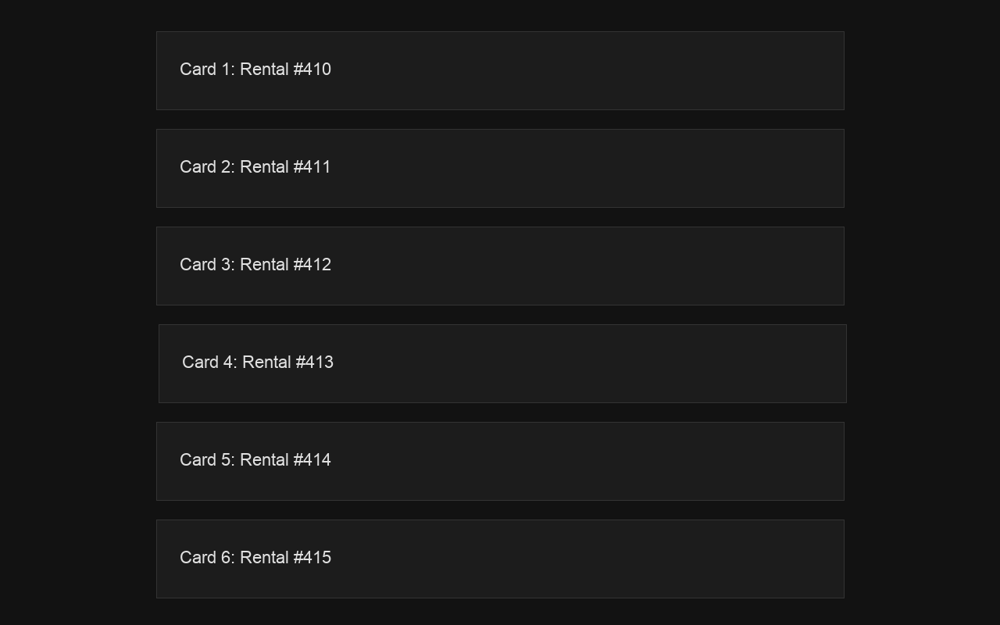

**Prompt**

> Are all six cards exactly left-aligned? If one is shifted, which one and which direction?
> End your reply with one final line exactly in this form: ANSWER: Card <n> <left|right> or ANSWER: all aligned

**F16 @6144** (45.9 s, 1104 prompt tokens, 8203 completion tokens)

> Looking at the left vertical border of each rectangle, all six cards begin at the same horizontal position (the same left margin from the page edge). The text inside each card also starts at the same x‑coordinate, confirming the left edges coincide. There is no card whose left edge is offset relative to the others.
>
> ANSWER: all aligned

**F16 @2048** (46.2 s, 1104 prompt tokens, 8203 completion tokens)

> Looking at the left vertical border of each rectangle, all six cards begin at the same horizontal position (the same left margin from the page edge). The text inside each card also starts at the same x‑coordinate, confirming the left edges coincide. There is no card whose left edge is offset relative to the others.
>
> ANSWER: all aligned

**Q8_0 @6144** (59.1 s, 1104 prompt tokens, 9139 completion tokens)

> Looking at the left edge of each rectangle and the starting position of the text inside each card, all six left borders line up on the same vertical line, and the text in every card begins at the same horizontal offset. Card 4 does look slightly different, but that difference is on its *right* side (the rectangle is a bit wider), not on its left side — its left edge and its text are still aligned with the others. A wider box that is left‑anchored does not constitute a horizontal shift, so no card is displaced left or right.
>
> ANSWER: all aligned

**Q6_K @6144** (53.6 s, 1104 prompt tokens, 9112 completion tokens)

> Looking carefully at the left edge of each card's rectangle and the left edge of the text inside it, all six cards share the same left x‑position (the left borders form a single straight vertical line, and the text "Card N: Rental #…" starts at the same horizontal offset in every card). The right edges also line up, confirming equal widths and equal left positions. No card is offset horizontally relative to the others.
>
> ANSWER: all aligned

**Q4_0 @6144** (55.0 s, 1104 prompt tokens, 9077 completion tokens)

> Looking carefully at the left edge of each card rectangle (and the left edge of the text inside each, which shares the same padding), all six left borders line up on the same vertical line. There is no horizontal offset on any card relative to the others.
>
> ANSWER: all aligned

## e04-dark-faint-dividers.png

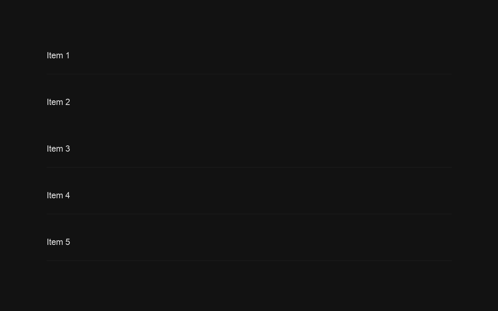

**Prompt**

> Some items have a very faint divider line under them. Which item does NOT have one?
> End your reply with one final line exactly in this form: ANSWER: Item <n> or ANSWER: all have one

**F16 @6144** (4.9 s, 1099 prompt tokens, 771 completion tokens)

> Looking carefully at the faint horizontal divider lines beneath each label:
>
> - **Item 1** – faint line present (~y=237)
> - **Item 2** – no line visible in the gap below it
> - **Item 3** – faint line present (~y=537)
> - **Item 4** – faint line present (~y=687)
> - **Item 5** – faint line present (~y=837)
>
> The gap under Item 2 is uniformly dark, with no divider line, unlike the others.
>
> ANSWER: Item 2

**F16 @2048** (4.9 s, 1099 prompt tokens, 771 completion tokens)

> Looking carefully at the faint horizontal divider lines beneath each label:
>
> - **Item 1** – faint line present (~y=237)
> - **Item 2** – no line visible in the gap below it
> - **Item 3** – faint line present (~y=537)
> - **Item 4** – faint line present (~y=687)
> - **Item 5** – faint line present (~y=837)
>
> The gap under Item 2 is uniformly dark, with no divider line, unlike the others.
>
> ANSWER: Item 2

**Q8_0 @6144** (6.4 s, 1099 prompt tokens, 1048 completion tokens)

> Looking at the faint horizontal divider lines beneath each entry, I can trace them at roughly these vertical positions:
>
> - Item 1 → line present (~y=237)
> - Item 2 → **no line** (the gap between Item 2 and Item 3 is empty)
> - Item 3 → line present (~y=537)
> - Item 4 → line present (~y=687)
> - Item 5 → line present (~y=837)
>
> The expected line after Item 2 (around y=387) is missing, while all other items have one.
>
> ANSWER: Item 2

**Q6_K @6144** (5.3 s, 1099 prompt tokens, 861 completion tokens)

> Looking carefully at the faint horizontal divider lines beneath each label, I can trace them at a consistent offset below the text. There is a faint line under Item 1, under Item 3, under Item 4, and under Item 5. The space directly below Item 2, however, contains no divider line.
>
> ANSWER: Item 2

**Q4_0 @6144** (5.0 s, 1099 prompt tokens, 793 completion tokens)

> Looking carefully at the faint horizontal divider lines beneath each label:
>
> - **Item 1** – has a faint line below it (~y=235)
> - **Item 2** – no line below it; the space between Item 2 and Item 3 is uniformly dark
> - **Item 3** – has a faint line below it (~y=535)
> - **Item 4** – has a faint line below it (~y=685)
> - **Item 5** – has a faint line below it (~y=835)
>
> So the item missing a divider is Item 2.
>
> ANSWER: Item 2

## e06-dark-count-10-lines.png

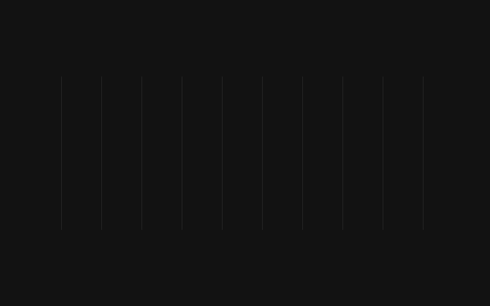

**Prompt**

> Count the thin vertical lines exactly.
> End your reply with one final line exactly in this form: ANSWER: <number>

**F16 @6144** (3.7 s, 1080 prompt tokens, 592 completion tokens)

> Looking carefully across the dark background, I can identify each thin vertical line by its horizontal position. Tracing from left to right, the lines appear at evenly spaced intervals (roughly every 82 pixels):
>
> 1. ~125
> 2. ~208
> 3. ~289
> 4. ~372
> 5. ~454
> 6. ~536
> 7. ~618
> 8. ~700
> 9. ~782
> 10. ~864
>
> This gives a total of 10 vertical lines.
>
> ANSWER: 10

**F16 @2048** (3.8 s, 1080 prompt tokens, 592 completion tokens)

> Looking carefully across the dark background, I can identify each thin vertical line by its horizontal position. Tracing from left to right, the lines appear at evenly spaced intervals (roughly every 82 pixels):
>
> 1. ~125
> 2. ~208
> 3. ~289
> 4. ~372
> 5. ~454
> 6. ~536
> 7. ~618
> 8. ~700
> 9. ~782
> 10. ~864
>
> This gives a total of 10 vertical lines.
>
> ANSWER: 10

**Q8_0 @6144** (3.7 s, 1080 prompt tokens, 578 completion tokens)

> Looking at the image, I traced each thin vertical line from left to right. They are evenly spaced across the dark background.
>
> Counting them in order:
> 1. First line (leftmost)
> 2. Second line
> 3. Third line
> 4. Fourth line
> 5. Fifth line
> 6. Sixth line
> 7. Seventh line
> 8. Eighth line
> 9. Ninth line
> 10. Tenth line (rightmost)
>
> This gives a total of 10 vertical lines.
>
> ANSWER: 10

**Q6_K @6144** (3.6 s, 1080 prompt tokens, 577 completion tokens)

> Looking carefully at the image, I traced each thin vertical line from left to right. They are evenly spaced across the dark background.
>
> Counting them in order:
> 1. ~x=125
> 2. ~x=208
> 3. ~x=289
> 4. ~x=372
> 5. ~x=454
> 6. ~x=536
> 7. ~x=618
> 8. ~x=700
> 9. ~x=782
> 10. ~x=864
>
> That gives a total of 10 vertical lines.
>
> ANSWER: 10

**Q4_0 @6144** (3.5 s, 1080 prompt tokens, 557 completion tokens)

> Looking carefully at the image from left to right, I can identify each thin vertical line by its horizontal position:
>
> 1. ~x=125
> 2. ~x=208
> 3. ~x=289
> 4. ~x=372
> 5. ~x=454
> 6. ~x=536
> 7. ~x=618
> 8. ~x=700
> 9. ~x=782
> 10. ~x=864
>
> The lines are evenly spaced (about 82 pixels apart), giving a total of 10 vertical lines.
>
> ANSWER: 10

## e08-dark-columns-3px.png

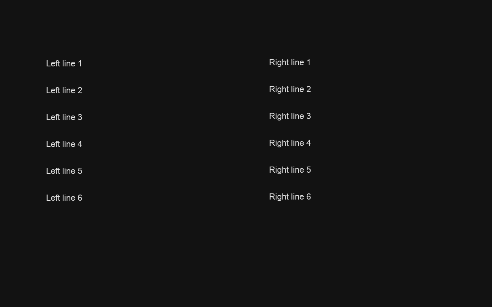

**Prompt**

> Are the left and right text columns on exactly the same baselines? If not, which column sits lower?
> End your reply with one final line exactly in this form: ANSWER: left / right / same

**F16 @6144** (5.8 s, 1097 prompt tokens, 944 completion tokens)

> Looking at each pair of lines, the right column is consistently offset upward by a few pixels relative to the left column (e.g., "Right line 1" sits slightly higher than "Left line 1", and the same small gap repeats down through line 6). Both columns use the same line spacing, but the right column's baseline is higher, meaning the left column sits lower.
>
> ANSWER: left

**F16 @2048** (5.9 s, 1097 prompt tokens, 944 completion tokens)

> Looking at each pair of lines, the right column is consistently offset upward by a few pixels relative to the left column (e.g., "Right line 1" sits slightly higher than "Left line 1", and the same small gap repeats down through line 6). Both columns use the same line spacing, but the right column's baseline is higher, meaning the left column sits lower.
>
> ANSWER: left

**Q8_0 @6144** (9.3 s, 1097 prompt tokens, 1523 completion tokens)

> Looking closely at the vertical positions of each line, the two columns are not perfectly aligned. The right column's lines sit a few pixels higher than the corresponding left column's lines (e.g., "Right line 1" is slightly above "Left line 1", and the same offset holds down through line 6). Since the right column is shifted upward, the left column is the one that sits lower.
>
> ANSWER: left

**Q6_K @6144** (5.7 s, 1097 prompt tokens, 905 completion tokens)

> Looking closely at each pair of lines, the right column is consistently positioned a few pixels higher than the left column (e.g., "Right line 1" sits above "Left line 1", and the same offset holds down through line 6). The vertical spacing between lines is identical in both columns, so the offset is a constant shift rather than a drift. Because the right column is higher, the left column is the one that sits lower.
>
> ANSWER: left

**Q4_0 @6144** (6.3 s, 1097 prompt tokens, 1016 completion tokens)

> Looking closely at each pair of lines, the right column's text sits consistently a few pixels higher than the left column's text. For example, "Right line 1" is positioned slightly above "Left line 1", and the same small vertical offset repeats down through line 6 ("Right line 6" is above "Left line 6"). The line spacing within each column is identical, but the whole left column is shifted downward relative to the right column.
>
> Therefore the two columns are not on exactly the same baselines, and the left column sits lower.
>
> ANSWER: left

