### What did you measure

> **Run and written entirely by Claude Opus 5.5** (Anthropic), working as an AI agent on the box owner's behalf with his OK. No human ran a command or edited a number. All pictures, questions, reference answers, raw answers (incl. reasoning text) and scripts: [vision-encoders-ui-20261112](https://github.com/q8atnight/Strata/tree/vision-encoders-ui-20261112/bench/vision-encoders-ui-20261112).

**How well does Qwen3.8-Flash-Next (Gyro-M) read UI screenshots on Strata — thin lines, spacing, alignment, symmetry — and what do the picture-token cap and the vision projector (`mmproj`) precision change?** Three findings:

1. **Picture-token cap:** this projector uses 32×32 px per image token. Raising `vision.max_tokens` from 2,048 to **6,144** fits on this box (8,192 does not, safely) and lets a 2560×1600 screenshot in unscaled. Small gain (+1.5 of 38 real-screenshot facts), +3.4 s per full screenshot.
2. **mmproj F16 vs Q8_0 vs Q6_K vs Q4_0: no quality ranking.** Differences are 1-3 single questions either way and do not follow bit depth. Speed is identical; only VRAM differs.
3. **Dark mode is the weak spot.** Every variant got 9/9 light-mode probes, but **no variant saw a 3-4 px card shift or a 3 px baseline offset on a dark background** (#1c1c1c cards, #333 borders on #121212) — while light probes with differences of the same order (a 20-vs-12 px gap, circles 30 vs 34 px, a dialog 12 px off-centre) were found by every variant.

**Setup**
- **Hardware:** 2× RTX 3090 24 GB (400 W), NVLink, PCIe gen4 x8 each; Ryzen 9 3950X; 121 GiB DDR4; Ubuntu 26.04.1, kernel 7.0.0-42, driver 595.99.02.
- **Strata:** v0.2.9 (engine 0.1.55) + carries (#1937 disk parking, #1099's NVLink hand-off, a table-only PLE shard fix), head `7140e957`. Not an official release.
- **Model:** `agentionai/Qwen3.8-Flash-Next-Gyro-GGUF` Gyro-M-TQ2_0, `--layer-split 24 --resident-experts --kv int8 --max-context 262144 --ple-io ram --mtp …`, all 12,288 experts per card resident. GPU picture reader `strata-vision-cuda` on CUDA0 (flash-attn auto).
- **Projectors:** F16 = unsloth `mmproj-Qwen3.8-Flash-Next-F16.gguf` (904 MB); Q8_0 = ggml-org (617 MB); **Q6_K and Q4_0 made from the F16 file with `llama-quantize`** (no published ones exist). Vision width 1,152 is not a multiple of 256, so **"Q6_K" is only the 2 projector matrices at Q6_K with 81 matrices falling back to Q8_0 (≈ Q8_0, 605 MB)**; Q4_0 is genuinely 4-bit (83 matrices, 458 MB). The 27 `ffn_down` (rows 4,304) stay F16 in every variant, including ggml-org's Q8_0.
- **Requests:** `/v1/chat/completions`, one picture + question, `temperature 0`, thinking on, one at a time; engine restarted for every arm. Greedy repeats on this engine were byte-identical (checked 32/32 on the same setup the same day), so differences are the projector or the cap, not sampling.

### 1. How big may a picture be?

Picture reader alone (engine stopped), one picture at the cap, F16:

| `vision.max_tokens` | ≈ pixels | reader VRAM | encode time |
|---:|---|---:|---:|
| 2,048 | 2.1 MP | 1,505 MiB | 1.6 s |
| 4,096 | 4.2 MP (2560×1600) | 1,835 MiB | 3.8 s |
| 6,144 | 6.3 MP | 2,143 MiB | 7.3 s |
| 8,192 | 8.4 MP | 2,463 MiB | 12.3 s |
| 12,288 | 12.6 MP | 3,113 MiB | 26 s |
| 16,384 | 16.8 MP | 3,761 MiB | 46 s |

~160 MiB per 1,000 tokens; encode time grows faster than linear. Q8_0 / Q6_K / Q4_0: same encode time, 270-430 MiB less VRAM.

**Trap: the reader warms up at `min(cap, 4096)` tokens** (`warmed up at 4096 image tokens`), so above 4,096 the extra VRAM is taken by the first big picture, after the engine has sized its expert cache. Live with the engine: at 8,192 a 5120×3200 picture left CUDA0 with 267 MiB and the server printed `only 266 MiB of VRAM free … below 512 MiB … the driver can page GPU memory (#2065)`. **At 6,144: 1,074 MiB free at start, 587 MiB after the largest picture, no warning across five restarts.** Mtmd also warns that Qwen-VL wants ≥1,024 image tokens for grounding (`--image-min-tokens`) — not tested here.

### 2. Results

Test set: **25 pictures** — 7 real UI screenshots of a small car-rental app (5 dark, 2 light; all names/plates/numbers are fictional demo data; 38 graded questions), 9 light synthetic probes and 9 dark synthetic probes (1280×800, 1 px = 1 px, exact ground truth, each ends with a fixed `ANSWER:` line and is scored automatically).

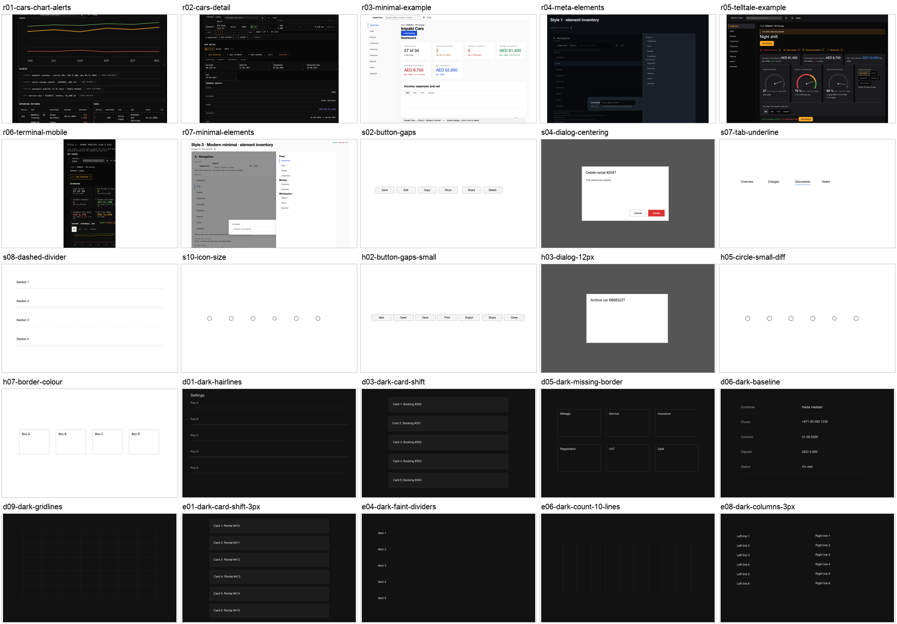

| | F16 @6144 | F16 @2048 | Q8_0 @6144 | Q6_K @6144 | Q4_0 @6144 |
|---|---:|---:|---:|---:|---:|
| real screenshots, 38 facts | 34.5 | 33 | 36 | 34.5 | 33 |
| synthetic light, 9 | 9 | 9 | 9 | 9 | 9 |
| synthetic dark, 9 | 5.8 | 5.8 | 4.6 | 5.8 | 6 |
| CUDA0 free at start / after the largest picture (MiB) | 1,074 / 577 | 1,406 / 1,217 | 1,348 / 851 | 1,360 / 863 | 1,502 / 1,007 |
| 2560×1720 screenshot: tokens · encode + LLM read (s) | 4,347 · 3.59 + 2.05 | 2,062 · 1.02 + 1.27 | 4,347 · 3.69 + 2.08 | 4,347 · 3.69 + 2.08 | 4,347 · 3.76 + 2.07 |
| largest picture: tokens · time to first token (s) | 6,063 · 9.56 | 2,019 · 2.31 | 6,063 · 9.83 | 6,063 · 9.79 | 6,063 · 9.79 |

Speed rows: fresh engine, `max_tokens 1`, thinking off; "LLM read" = the server's own `prompt N tokens … read in X ms`, encode = the rest of the wall time.

- **Cap:** F16 at 6,144 vs 2,048 = 34.5 vs 33. At full size the model got the monospace-font question fully right, the near-zero row gap right and a crowded label; it lost one (calls a 1-2 px gap "a small gap").
- **Projector:** Q8_0 best on real screenshots (36) but worst on dark probes (4.6); Q4_0 best on dark (6.0) but tied lowest on real (33). No consistent order.
- **Dark mode:** 4 px and 3 px card shifts ❌ all five, 3 px baseline offset ❌ all five, 1/2/3 px line weights: 2 px vs 1 px missed by all but Q4_0. Light: all 9 probes ✅ for all five (8 px gap difference, 4 px circle difference, 12 px and 40 px off-centre dialogs, a bluish-grey border among grey ones, a dashed divider, a 2 px tab underline). Found in dark: a missing 1 px border side, a `#1f1f1f`-on-`#121212` divider, 10-line and 8×6 grid counts (Q8_0 counted 9), a 3 px column offset.

### 3. Every picture

✅ right · ◐ partly · ❌ wrong. Full answers of all five arms: [ANSWERS-r2.md](https://github.com/q8atnight/Strata/blob/vision-encoders-ui-20261112/bench/vision-encoders-ui-20261112/post2/ANSWERS-r2.md).

<b>r01-cars-chart-alerts — F16 6, F16 2048 6, Q8_0 6, Q6_K 6, Q4_0 6 of 6</b>

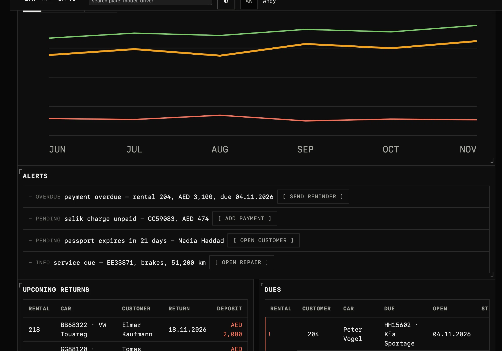

| # | question | reference | F16 @6144 | F16 @2048 | Q8_0 @6144 | Q6_K @6144 | Q4_0 @6144 |
|---|---|---|:-:|:-:|:-:|:-:|:-:|
| 1 | How many data lines are in the chart, and what colour is each? | 3: green, orange, red | ✅ | ✅ | ✅ | ✅ | ✅ |
| 2 | Which line is highest at NOV? | green | ✅ | ✅ | ✅ | ✅ | ✅ |
| 3 | How many alert rows are in ALERTS, and are their bracketed action buttons lined up in one common column (same left edge)? | 4 rows; NO - each button sits right after its text, ragged left edges | ✅ | ✅ | ✅ | ✅ | ✅ |
| 4 | In the DUES table, is any column header cut off at the right edge? Which? | yes, the last header is cut ('STA...' = status) | ✅ | ✅ | ✅ | ✅ | ✅ |
| 5 | In UPCOMING RETURNS, how is the deposit for rental 218 shown (colour, number of lines)? | 'AED 2,000' in red/salmon, wrapped over 2 lines | ✅ | ✅ | ✅ | ✅ | ✅ |
| 6 | Describe any small decorative marks at the corners of the panels. | thin L-shaped corner brackets at top-left and bottom-right of panels | ✅ | ✅ | ✅ | ✅ | ✅ |

<b>r02-cars-detail — F16 6.5, F16 2048 7, Q8_0 6.5, Q6_K 6.5, Q4_0 5.5 of 8</b>

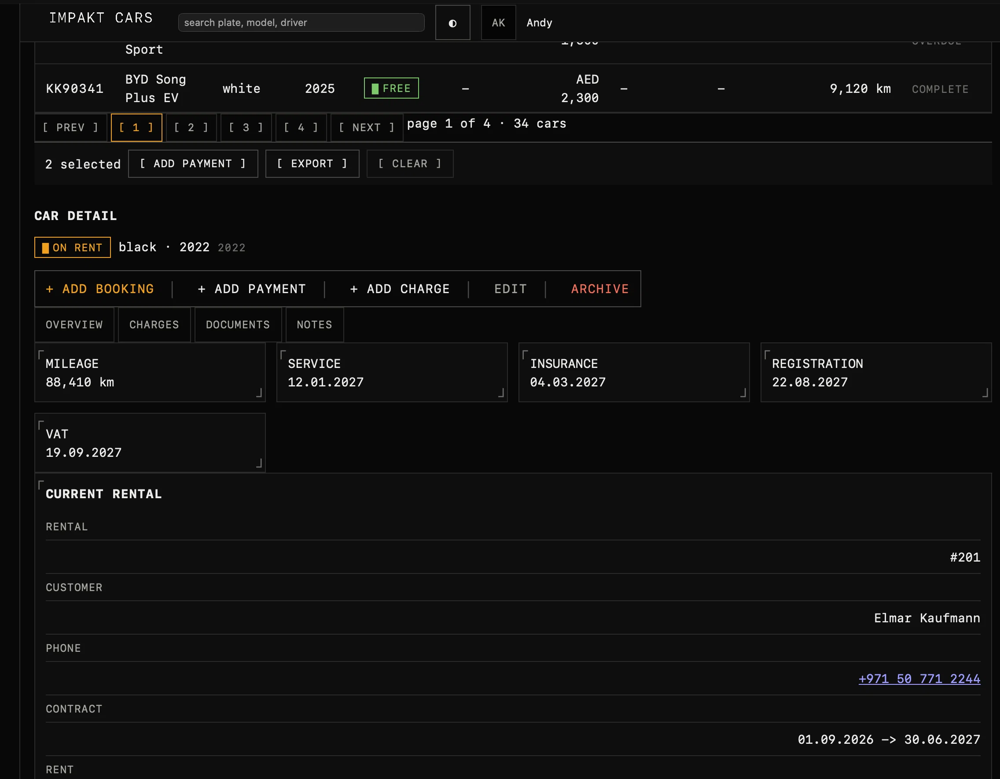

| # | question | reference | F16 @6144 | F16 @2048 | Q8_0 @6144 | Q6_K @6144 | Q4_0 @6144 |
|---|---|---|:-:|:-:|:-:|:-:|:-:|
| 1 | Which pagination button is the active page and how is it marked? | [ 1 ], orange outline/text | ✅ | ✅ | ✅ | ✅ | ✅ |
| 2 | Of the three buttons after '2 selected', which looks disabled/dimmed? | CLEAR | ✅ | ✅ | ✅ | ✅ | ✅ |
| 3 | The line under CAR DETAIL repeats one value. What is repeated? | the year 2022 ('black · 2022 2022') | ✅ | ✅ | ✅ | ✅ | ✅ |
| 4 | How many info tiles are in the first row, and where does the next tile go? | 4 (Mileage, Service, Insurance, Registration); VAT wraps alone to a second row | ✅ | ✅ | ✅ | ✅ | ✅ |
| 5 | How many thin vertical separator lines are between the items of the action bar (+ ADD BOOKING ... ARCHIVE)? | 4 | ✅ | ✅ | ✅ | ✅ | ✅ |
| 6 | Which of the tabs OVERVIEW / CHARGES / DOCUMENTS / NOTES looks selected? | none is clearly marked as selected | ❌ | ❌ | ❌ | ❌ | ❌ |
| 7 | Is there a visible gap between the tab row and the tiles below it? | no / almost none - tabs touch the tiles | ◐ | ✅ | ◐ | ◐ | ◐ |
| 8 | In CURRENT RENTAL, where is each value placed relative to its label? | label on its own line at left; value on the next line, right-aligned far away | ✅ | ✅ | ✅ | ✅ | ❌ |

*Grading note:* Q6 all say OVERVIEW selected; zoom shows all four tabs identical. Q7 zoom: 1-2 px between tabs and tiles; 'a small gap' = half. Q8 Q4_0 says value on the SAME line (wrong)

<b>r03-minimal-example — F16 4.5, F16 2048 4, Q8_0 4.5, Q6_K 5, Q4_0 4 of 5</b>

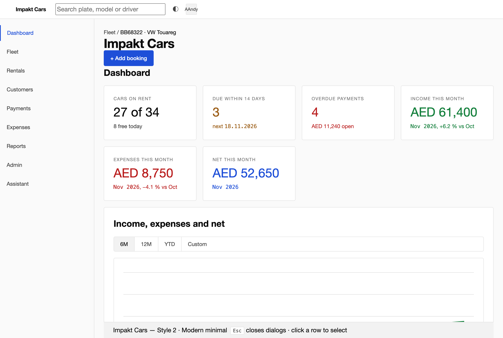

| # | question | reference | F16 @6144 | F16 @2048 | Q8_0 @6144 | Q6_K @6144 | Q4_0 @6144 |
|---|---|---|:-:|:-:|:-:|:-:|:-:|
| 1 | What text is in the user chip at the top right of the top bar, exactly as written? | 'AAndy' (initial and name run together) | ✅ | ✅ | ✅ | ✅ | ✅ |
| 2 | How much space is there between the blue '+ Add booking' button and the 'Impakt Cars' title above it and the 'Dashboard' heading below it? | almost none - button touches title and heading (cramped) | ◐ | ◐ | ◐ | ✅ | ◐ |
| 3 | How many KPI cards are in the first row and in the second row? | 4 and 2 | ✅ | ✅ | ✅ | ✅ | ✅ |
| 4 | Which KPI subtitle lines use a different (monospace) font from the rest? | the date/month parts: 'next 18.11.2026', 'Nov 2026' (x3) | ✅ | ◐ | ✅ | ✅ | ◐ |
| 5 | What happens at the very bottom of the screen with the grey bar and the chart? | a sticky grey footer bar covers the bottom of the chart | ✅ | ✅ | ✅ | ✅ | ✅ |

*Grading note:* Q2 measured ~4 / ~7 px: Q6_K '5-8 px' right, others 8-20 px. Q4 at full size F16/Q8/Q6_K correctly leave out 'AED 11,240 open'; 2048 and Q4_0 include it

<b>r04-meta-elements — F16 3.5, F16 2048 3, Q8_0 4, Q6_K 2.5, Q4_0 2.5 of 4</b>

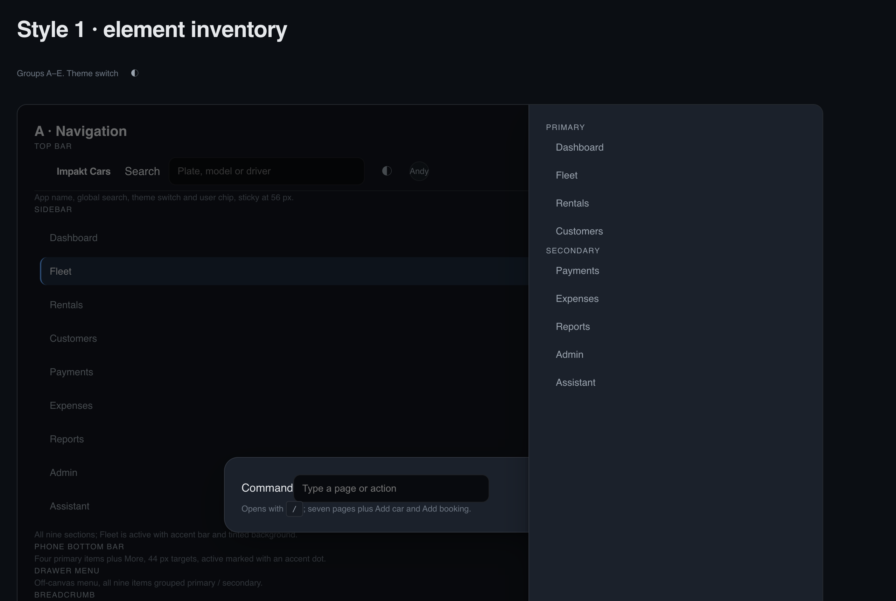

| # | question | reference | F16 @6144 | F16 @2048 | Q8_0 @6144 | Q6_K @6144 | Q4_0 @6144 |
|---|---|---|:-:|:-:|:-:|:-:|:-:|
| 1 | Which elements overlap each other on this page? | the Command box overlaps the sidebar list and the caption text below; the right panel covers the right part of the Navigation section | ◐ | ◐ | ✅ | ◐ | ◐ |
| 2 | Which sidebar item is active and how is it marked? | Fleet: accent/blue left bar + tinted background | ✅ | ✅ | ✅ | ✅ | ✅ |
| 3 | What are the two group headings in the right-hand panel? | PRIMARY and SECONDARY | ✅ | ✅ | ✅ | ✅ | ✅ |
| 4 | Is the 'A · Navigation' heading the same brightness as normal text? | no - dimmer/greyer (low contrast) | ✅ | ◐ | ✅ | ❌ | ❌ |

*Grading note:* Q1 only Q8_0 names both overlaps. Q4 Q6_K/Q4_0 answer 'Yes, same brightness'

<b>r05-telltale-example — F16 5.5, F16 2048 5, Q8_0 6, Q6_K 6, Q4_0 6 of 6</b>

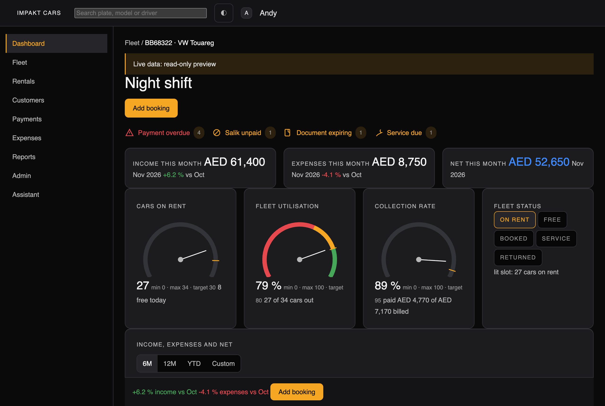

| # | question | reference | F16 @6144 | F16 @2048 | Q8_0 @6144 | Q6_K @6144 | Q4_0 @6144 |
|---|---|---|:-:|:-:|:-:|:-:|:-:|
| 1 | List the four alert chips under 'Add booking' with their counts. | Payment overdue 4, Salik unpaid 1, Document expiring 1, Service due 1 | ✅ | ✅ | ✅ | ✅ | ✅ |
| 2 | Which FLEET STATUS chip is highlighted? | ON RENT | ✅ | ✅ | ✅ | ✅ | ✅ |
| 3 | Look at the text under each gauge. Is anything wrong with how it wraps or runs together? | yes - target value is split from 'target' and runs into the next text: 'target 30 8 / free today', '80 27 of 34 cars out', '95 paid AED...' | ✅ | ✅ | ✅ | ✅ | ✅ |
| 4 | Do the left/right edges of the 3 top summary cards line up with the edges of the 4 gauge cards below them? | no - 3-column and 4-column grids don't align | ◐ | ✅ | ✅ | ✅ | ✅ |
| 5 | Compare the vertical gap between the summary row and the gauge row with the horizontal gaps between cards. Consistent? | no - vertical gap ~0 (cards touch), horizontal gap ~16 px | ✅ | ❌ | ✅ | ✅ | ✅ |
| 6 | What colours are on the FLEET UTILISATION gauge arc? | red, amber/orange, green | ✅ | ✅ | ✅ | ✅ | ✅ |

*Grading note:* Q5 (rows almost touch): only F16@2048 says 'larger' (wrong). Q4 F16@6144 opens with 'Yes'

<b>r06-terminal-mobile — F16 3.5, F16 2048 3.5, Q8_0 4, Q6_K 4, Q4_0 4 of 4</b>

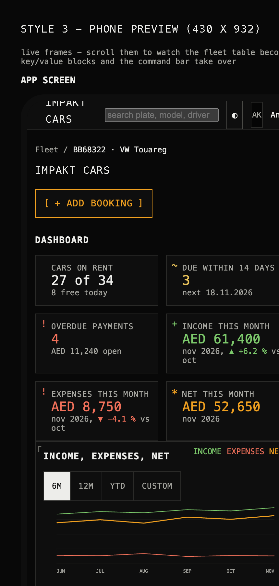

| # | question | reference | F16 @6144 | F16 @2048 | Q8_0 @6144 | Q6_K @6144 | Q4_0 @6144 |
|---|---|---|:-:|:-:|:-:|:-:|:-:|
| 1 | What content is cut off at the right edge of the phone frame? | user name 'An(dy)', right card column text ('vs'), chart legend 'NE(T)', card right edges | ◐ | ◐ | ✅ | ✅ | ✅ |
| 2 | Which single-character symbols appear before the card titles, and on which cards? | ~ due within 14 days; ! overdue payments; + income; ! expenses; * net (none on cars on rent) | ✅ | ✅ | ✅ | ✅ | ✅ |
| 3 | Is the 'IMPAKT CARS' logo text in the top bar fully visible? | no - top of 'IMPAKT' is clipped | ✅ | ✅ | ✅ | ✅ | ✅ |
| 4 | Which range tab (6M / 12M / YTD / CUSTOM) is active and how is it shown? | 6M, light/white filled background | ✅ | ✅ | ✅ | ✅ | ✅ |

*Grading note:* Q1 both F16 runs miss the clipped right card column

<b>r07-minimal-elements — F16 5, F16 2048 4.5, Q8_0 5, Q6_K 4.5, Q4_0 5 of 5</b>

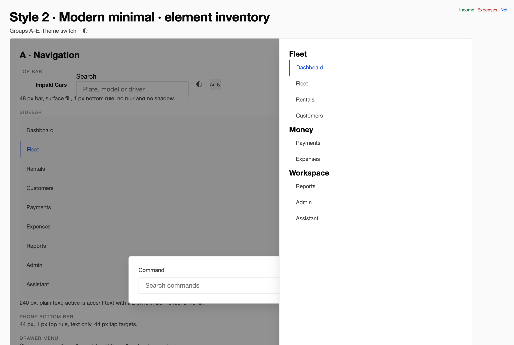

| # | question | reference | F16 @6144 | F16 @2048 | Q8_0 @6144 | Q6_K @6144 | Q4_0 @6144 |
|---|---|---|:-:|:-:|:-:|:-:|:-:|
| 1 | Describe any text or elements that overlap or collide in the TOP BAR area. | 'Search' label floats above the input; the input overlaps the caption '48 px bar...' below it | ✅ | ◐ | ✅ | ◐ | ✅ |
| 2 | Which item is active in the left SIDEBAR, and which in the right panel? How are they marked? | Fleet in sidebar, Dashboard in right panel; blue text + thin blue left rule | ✅ | ✅ | ✅ | ✅ | ✅ |
| 3 | What are the group headings in the right panel? | Fleet, Money, Workspace | ✅ | ✅ | ✅ | ✅ | ✅ |
| 4 | What is the small coloured text at the top right corner of the page? | a legend: Income (green), Expenses (red), Net (blue) | ✅ | ✅ | ✅ | ✅ | ✅ |
| 5 | Why does the left panel look grey? | a dark/grey modal overlay (scrim) dims it behind the drawer/command dialog | ✅ | ✅ | ✅ | ✅ | ✅ |

*Grading note:* Q1 credit when the crowded 'Search' label is named as well as the caption collision

<b>s02-button-gaps (light) — ✅ ✅ ✅ ✅ ✅</b>

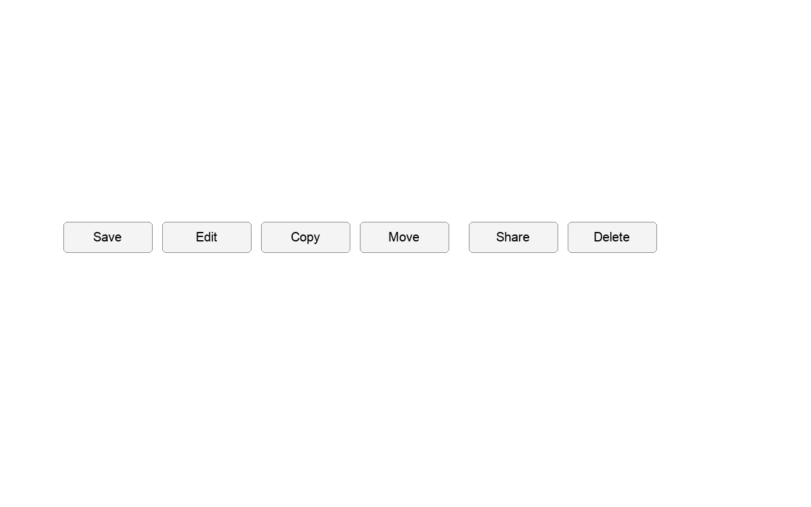

**Question:** How many buttons are there, and is the spacing between neighbouring buttons equal? If not, between which two buttons is the gap different?  
**Reference:** `Move-Share`

| arm | final ANSWER line | score |
|---|---|:-:|
| F16 @6144 | Move-Share | ✅ |
| F16 @2048 | Move-Share | ✅ |
| Q8_0 @6144 | Move-Share | ✅ |
| Q6_K @6144 | Move-Share | ✅ |
| Q4_0 @6144 | Move-Share | ✅ |

<b>s04-dialog-centering (light) — ✅ ✅ ✅ ✅ ✅</b>

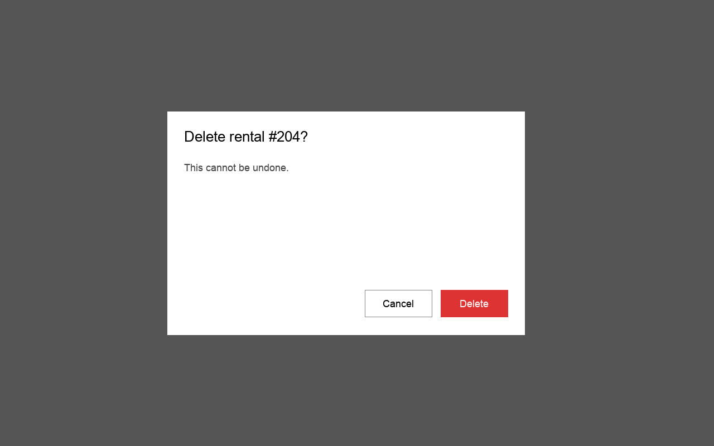

**Question:** Is the white dialog exactly horizontally centred on the dark background? If not, which side has the bigger margin?  
**Reference:** `bigger-right`

| arm | final ANSWER line | score |
|---|---|:-:|
| F16 @6144 | bigger-right | ✅ |
| F16 @2048 | bigger-right | ✅ |
| Q8_0 @6144 | bigger-right | ✅ |
| Q6_K @6144 | bigger-right | ✅ |
| Q4_0 @6144 | bigger-right | ✅ |

<b>s07-tab-underline (light) — ✅ ✅ ✅ ✅ ✅</b>

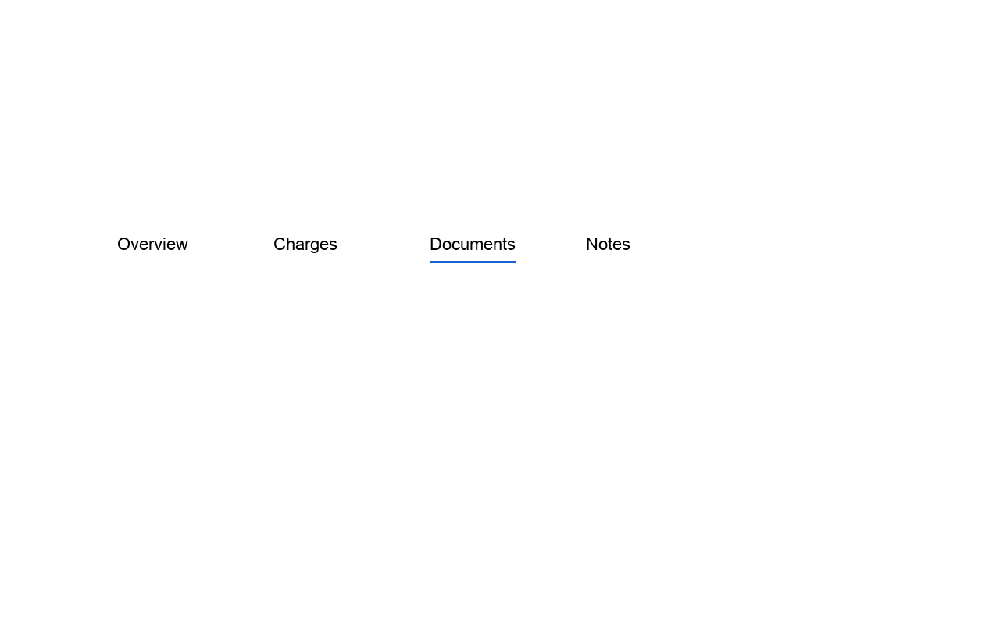

**Question:** Which tab is marked as the active tab, and how is it marked?  
**Reference:** `Documents`

| arm | final ANSWER line | score |
|---|---|:-:|
| F16 @6144 | Documents | ✅ |
| F16 @2048 | Documents | ✅ |
| Q8_0 @6144 | Documents | ✅ |
| Q6_K @6144 | Documents | ✅ |
| Q4_0 @6144 | Documents | ✅ |

<b>s08-dashed-divider (light) — ✅ ✅ ✅ ✅ ✅</b>

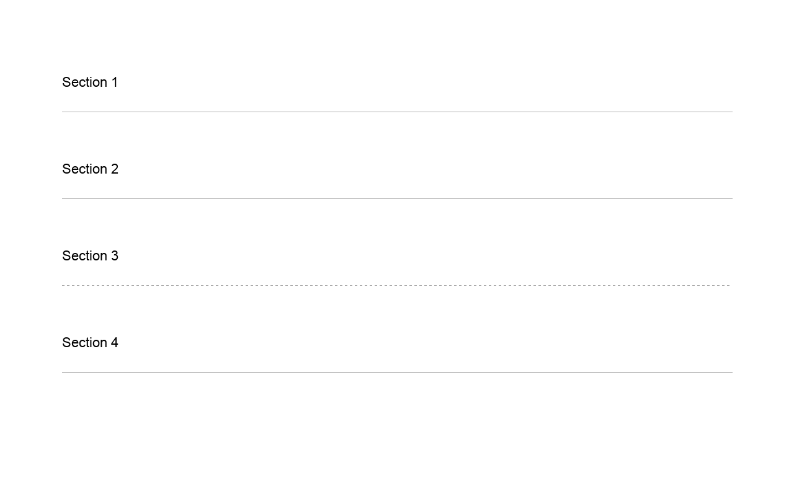

**Question:** Which divider line looks different from the others, and how?  
**Reference:** `Section 3`

| arm | final ANSWER line | score |
|---|---|:-:|
| F16 @6144 | Section 3 | ✅ |
| F16 @2048 | Section 3 | ✅ |
| Q8_0 @6144 | Section 3 | ✅ |
| Q6_K @6144 | Section 3 | ✅ |
| Q4_0 @6144 | Section 3 | ✅ |

<b>s10-icon-size (light) — ✅ ✅ ✅ ✅ ✅</b>

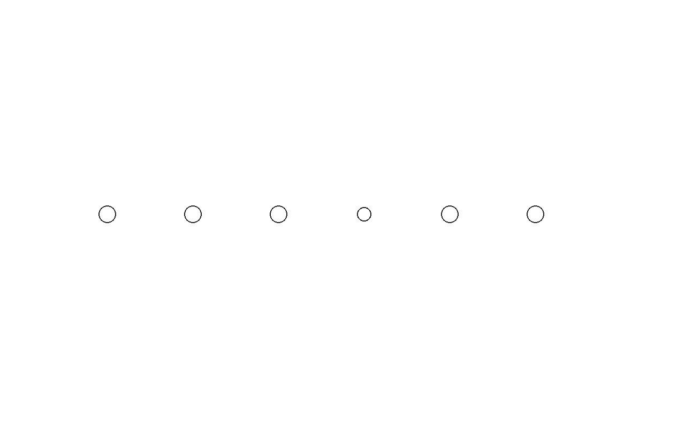

**Question:** Are all the circles the same size? If not, which one is different (count from the left) and how?  
**Reference:** `4 smaller`

| arm | final ANSWER line | score |
|---|---|:-:|
| F16 @6144 | 4 smaller | ✅ |
| F16 @2048 | 4 smaller | ✅ |
| Q8_0 @6144 | 4 smaller | ✅ |
| Q6_K @6144 | 4 smaller | ✅ |
| Q4_0 @6144 | 4 smaller | ✅ |

<b>h02-button-gaps-small (light) — ✅ ✅ ✅ ✅ ✅</b>

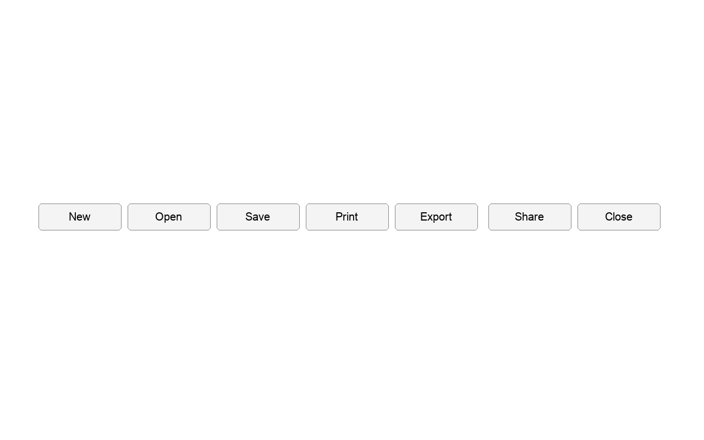

**Question:** Is the spacing between all neighbouring buttons exactly equal? If not, between which two buttons is it different?  
**Reference:** `Export-Share`

| arm | final ANSWER line | score |
|---|---|:-:|
| F16 @6144 | Export-Share | ✅ |
| F16 @2048 | Export-Share | ✅ |
| Q8_0 @6144 | Export-Share | ✅ |
| Q6_K @6144 | Export-Share | ✅ |
| Q4_0 @6144 | Export-Share | ✅ |

<b>h03-dialog-12px (light) — ✅ ✅ ✅ ✅ ✅</b>

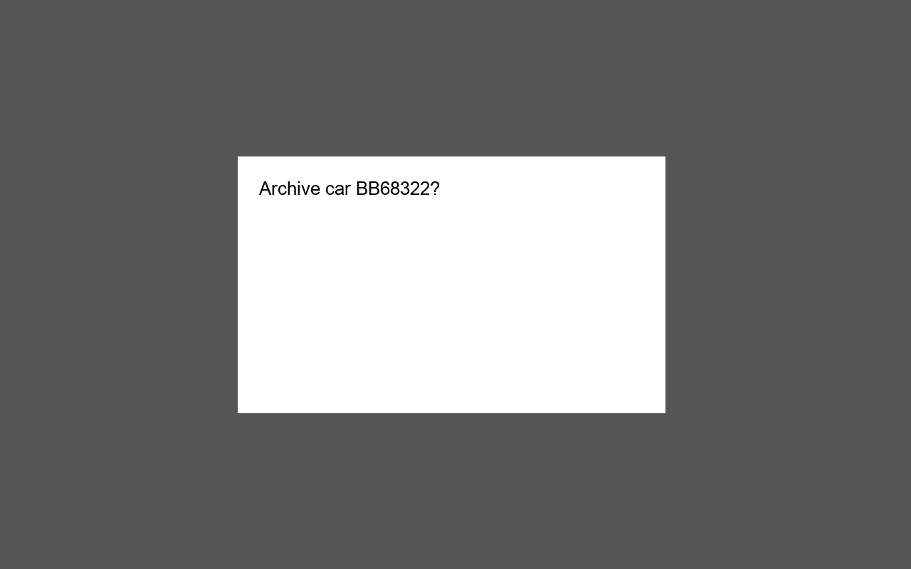

**Question:** Is the white dialog exactly horizontally centred? If not, which side has the bigger margin?  
**Reference:** `bigger-right`

| arm | final ANSWER line | score |
|---|---|:-:|
| F16 @6144 | bigger-right | ✅ |
| F16 @2048 | bigger-right | ✅ |
| Q8_0 @6144 | bigger-right | ✅ |
| Q6_K @6144 | bigger-right | ✅ |
| Q4_0 @6144 | bigger-right | ✅ |

<b>h05-circle-small-diff (light) — ✅ ✅ ✅ ✅ ✅</b>

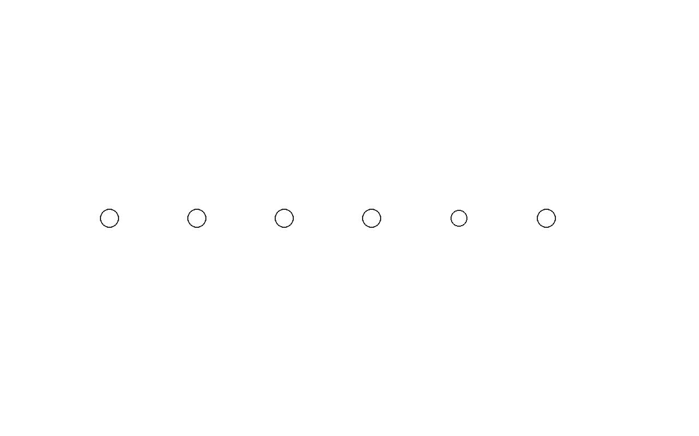

**Question:** Are all the circles exactly the same size? If not, which one (count from the left) differs?  
**Reference:** `5 smaller`

| arm | final ANSWER line | score |
|---|---|:-:|
| F16 @6144 | 5 smaller | ✅ |
| F16 @2048 | 5 smaller | ✅ |
| Q8_0 @6144 | 5 smaller | ✅ |
| Q6_K @6144 | 5 smaller | ✅ |
| Q4_0 @6144 | 5 smaller | ✅ |

<b>h07-border-colour (light) — ✅ ✅ ✅ ✅ ✅</b>

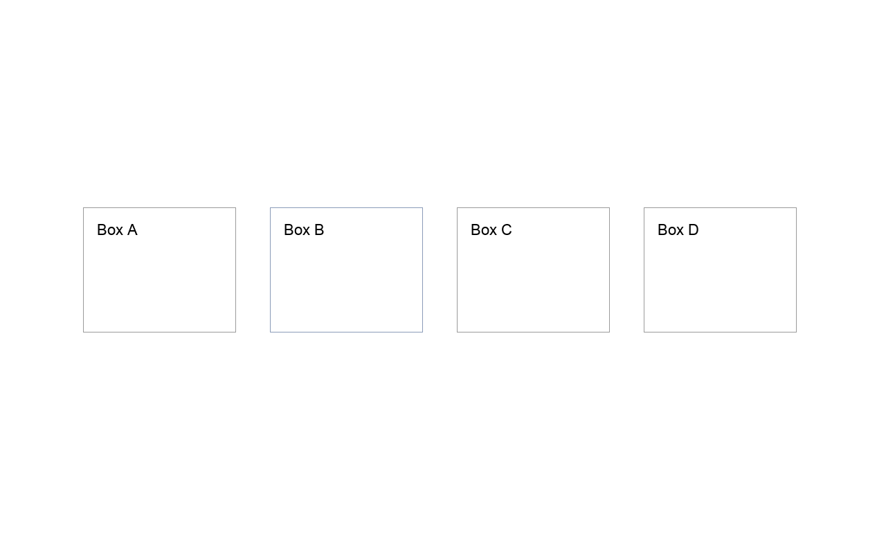

**Question:** Do all four boxes have the same border colour? If not, which box differs and how?  
**Reference:** `B`

| arm | final ANSWER line | score |
|---|---|:-:|
| F16 @6144 | B | ✅ |
| F16 @2048 | B | ✅ |
| Q8_0 @6144 | B | ✅ |
| Q6_K @6144 | Box B | ✅ |
| Q4_0 @6144 | B | ✅ |

<b>d01-dark-hairlines (dark) — 0.8 0.8 0.6 0.8 ✅</b>

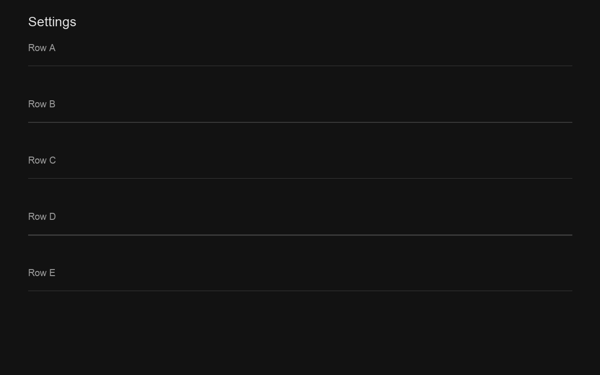

**Question:** There are horizontal divider lines under Row A to Row E. Are they all the same thickness? If not, give each row's line as thin / medium / thick.  
**Reference:** `A=thin B=medium C=thin D=thick E=thin`

| arm | final ANSWER line | score |
|---|---|:-:|
| F16 @6144 | A=thin B=thin C=thin D=thick E=thin | 0.8 |
| F16 @2048 | A=thin B=thin C=thin D=thick E=thin | 0.8 |
| Q8_0 @6144 | A=thin B=thin C=thin D=medium E=thin | 0.6 |
| Q6_K @6144 | A=thin B=thin C=thin D=thick E=thin | 0.8 |
| Q4_0 @6144 | A=thin B=medium C=thin D=thick E=thin | ✅ |

<b>d03-dark-card-shift (dark) — ❌ ❌ ❌ ❌ ❌</b>

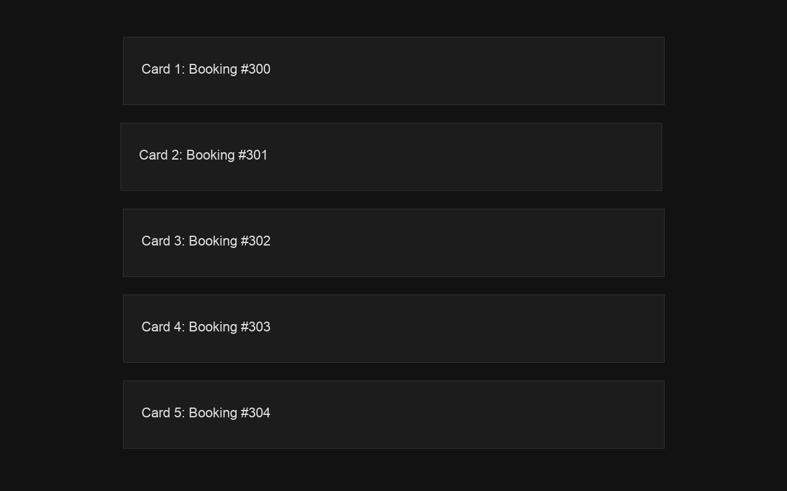

**Question:** Are all the cards exactly left-aligned? If one is shifted, which one and in which direction?  
**Reference:** `Card 2 left`

| arm | final ANSWER line | score |
|---|---|:-:|
| F16 @6144 | all aligned | ❌ |
| F16 @2048 | all aligned | ❌ |
| Q8_0 @6144 | all aligned | ❌ |
| Q6_K @6144 | all aligned | ❌ |
| Q4_0 @6144 | all aligned | ❌ |

<b>d05-dark-missing-border (dark) — ✅ ✅ ✅ ✅ ✅</b>

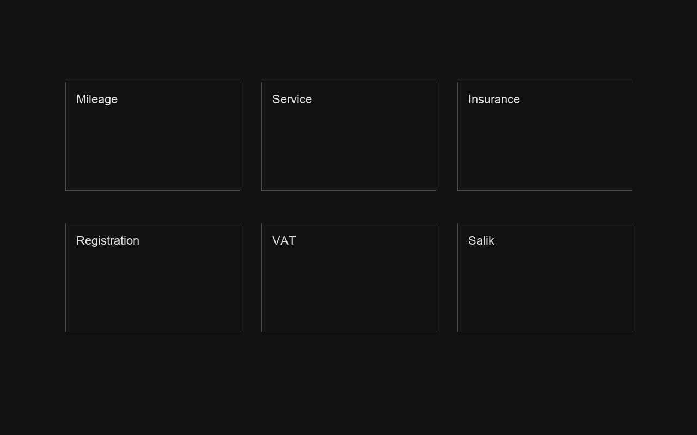

**Question:** Each box should have a complete border on all four sides. Is any box missing part of its border? Which box and which side?  
**Reference:** `Insurance right`

| arm | final ANSWER line | score |
|---|---|:-:|
| F16 @6144 | Insurance right | ✅ |
| F16 @2048 | Insurance right | ✅ |
| Q8_0 @6144 | Insurance right | ✅ |
| Q6_K @6144 | Insurance right | ✅ |
| Q4_0 @6144 | Insurance right | ✅ |

<b>d06-dark-baseline (dark) — ❌ ❌ ❌ ❌ ❌</b>

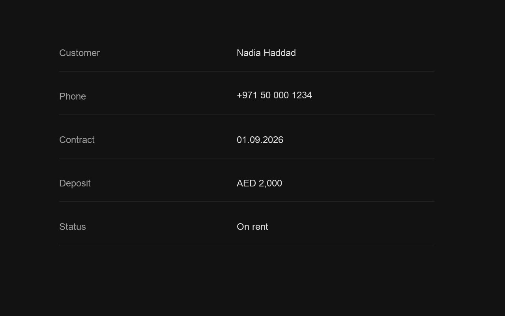

**Question:** In each row, is the value on the right exactly on the same baseline as its label on the left? If a row is off, which one, and is the value higher or lower?  
**Reference:** `Phone higher`

| arm | final ANSWER line | score |
|---|---|:-:|
| F16 @6144 | all aligned | ❌ |
| F16 @2048 | all aligned | ❌ |
| Q8_0 @6144 | all aligned | ❌ |
| Q6_K @6144 | all aligned | ❌ |
| Q4_0 @6144 | all aligned | ❌ |

<b>d09-dark-gridlines (dark) — ✅ ✅ ❌ ✅ ✅</b>

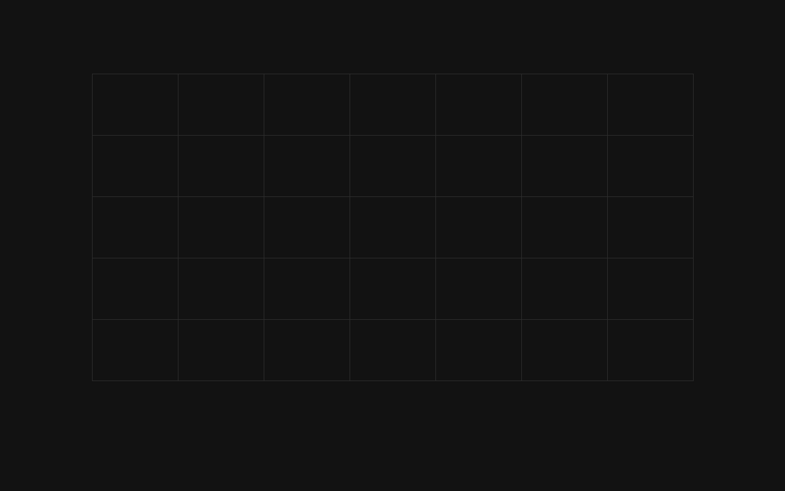

**Question:** Count the vertical lines and the horizontal lines in the grid, including the outer frame edges.  
**Reference:** `8 vertical, 6 horizontal`

| arm | final ANSWER line | score |
|---|---|:-:|
| F16 @6144 | 8 vertical, 6 horizontal | ✅ |
| F16 @2048 | 8 vertical, 6 horizontal | ✅ |
| Q8_0 @6144 | 9 vertical, 6 horizontal | ❌ |
| Q6_K @6144 | 8 vertical, 6 horizontal | ✅ |
| Q4_0 @6144 | 8 vertical, 6 horizontal | ✅ |

<b>e01-dark-card-shift-3px (dark) — ❌ ❌ ❌ ❌ ❌</b>

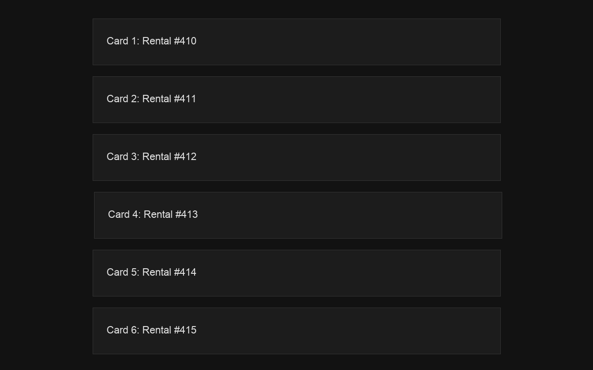

**Question:** Are all six cards exactly left-aligned? If one is shifted, which one and which direction?  
**Reference:** `Card 4 right`

| arm | final ANSWER line | score |
|---|---|:-:|
| F16 @6144 | all aligned | ❌ |
| F16 @2048 | all aligned | ❌ |
| Q8_0 @6144 | all aligned | ❌ |
| Q6_K @6144 | all aligned | ❌ |
| Q4_0 @6144 | all aligned | ❌ |

<b>e04-dark-faint-dividers (dark) — ✅ ✅ ✅ ✅ ✅</b>

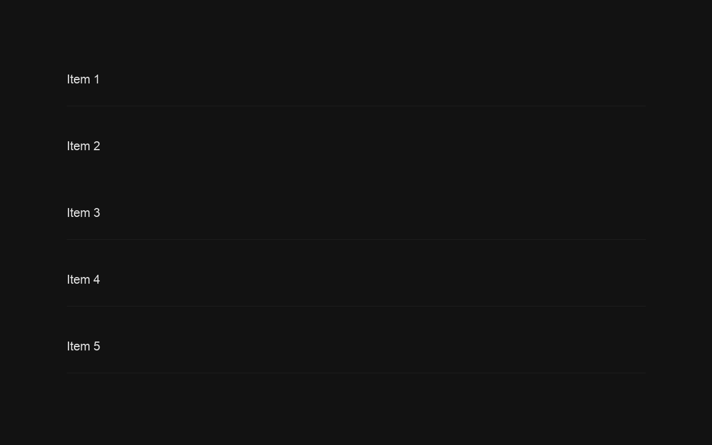

**Question:** Some items have a very faint divider line under them. Which item does NOT have one?  
**Reference:** `Item 2`

| arm | final ANSWER line | score |
|---|---|:-:|
| F16 @6144 | Item 2 | ✅ |
| F16 @2048 | Item 2 | ✅ |
| Q8_0 @6144 | Item 2 | ✅ |
| Q6_K @6144 | Item 2 | ✅ |
| Q4_0 @6144 | Item 2 | ✅ |

<b>e06-dark-count-10-lines (dark) — ✅ ✅ ✅ ✅ ✅</b>

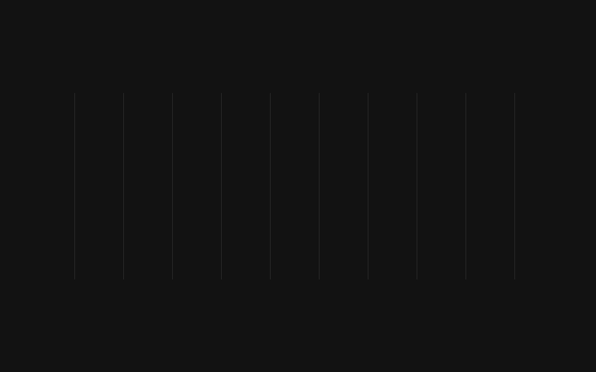

**Question:** Count the thin vertical lines exactly.  
**Reference:** `10`

| arm | final ANSWER line | score |
|---|---|:-:|
| F16 @6144 | 10 | ✅ |
| F16 @2048 | 10 | ✅ |
| Q8_0 @6144 | 10 | ✅ |
| Q6_K @6144 | 10 | ✅ |
| Q4_0 @6144 | 10 | ✅ |

<b>e08-dark-columns-3px (dark) — ✅ ✅ ✅ ✅ ✅</b>

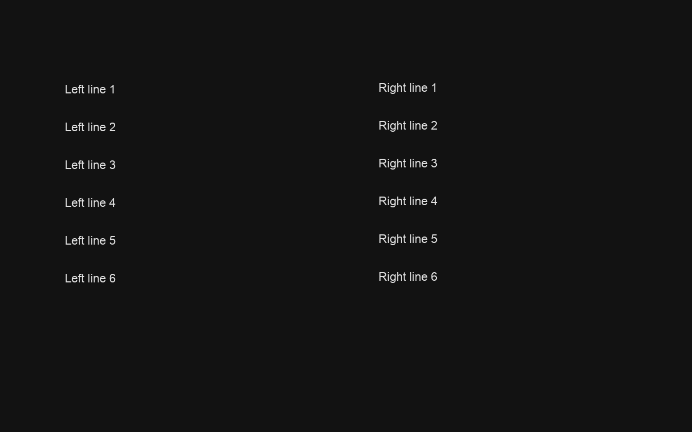

**Question:** Are the left and right text columns on exactly the same baselines? If not, which column sits lower?  
**Reference:** `left`

| arm | final ANSWER line | score |
|---|---|:-:|
| F16 @6144 | left | ✅ |
| F16 @2048 | left | ✅ |
| Q8_0 @6144 | left | ✅ |
| Q6_K @6144 | left | ✅ |
| Q4_0 @6144 | left | ✅ |

### Reproduce

`make_synth.py` / `make_hard.py` / `make_dark.py` draw the synthetic probes; `questions-v2.json` = questions + reference answers;
`run.py <label>` (env `STRATA_URL`, `STRATA_KEY`, `QFILE=questions-v2.json CRIT=0`) runs the set; `speed.py <label>` right after an engine
start; `score2.py <labels…>` scores the synthetic probes; `scores-v2-real.json` = hand grading; `probe.sh <mmproj> <cap>` = reader-alone VRAM/speed.
